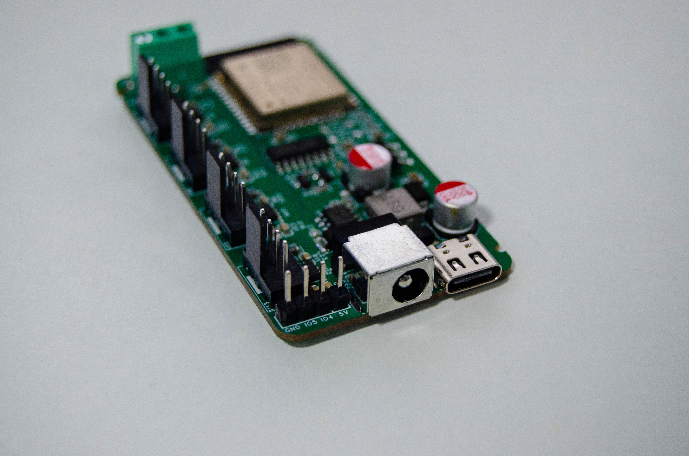

# 项目文档（Wiki）源文件

本目录是 [HomeAssistant-PWM-Fan-Controlx4](https://github.com/YUAXI/HomeAssistant-PWM-Fan-Controlx4) 的完整文档，中英双语，可直接发布为 GitHub Wiki。

## 目录结构

```text
docs/wiki/
├── README.md                 # 本文件：约定 + 发布方法
├── zh/                       # 中文页面
│   ├── _Sidebar.md           # 中文导航
│   ├── Home.md
│   ├── Getting-Started.md
│   ├── Firmware.md
│   ├── Entities.md
│   ├── Temperature-Control.md
│   ├── Radar.md
│   ├── HTTP-API.md
│   ├── Home-Assistant.md
│   ├── Hardware.md
│   ├── Troubleshooting.md
│   ├── FAQ.md
│   ├── Development.md
│   └── Changelog.md
├── en/                       # 英文页面（文件名统一加 -EN）
│   ├── _Sidebar.md
│   ├── Home-EN.md
│   └── ...（与 zh/ 一一对应）
└── （发布工具在仓库根的 scripts/：sync-wiki.ps1、sync-wiki.sh、check-wiki-links.py）
```

## 页面清单

| 页面 | 中文文件 | 英文文件 | Wiki 页面名（发布后） |
|:-----|:---------|:---------|:----------------------|
| 首页 | `zh/Home.md` | `en/Home-EN.md` | `Home` / `Home-EN` |
| 快速上手 | `zh/Getting-Started.md` | `en/Getting-Started-EN.md` | `Getting-Started` / `Getting-Started-EN` |
| 固件版本 | `zh/Firmware.md` | `en/Firmware-EN.md` | `Firmware` / `Firmware-EN` |
| 实体参考 | `zh/Entities.md` | `en/Entities-EN.md` | `Entities` / `Entities-EN` |
| 温度控制 | `zh/Temperature-Control.md` | `en/Temperature-Control-EN.md` | `Temperature-Control` / `Temperature-Control-EN` |
| 毫米波雷达 | `zh/Radar.md` | `en/Radar-EN.md` | `Radar` / `Radar-EN` |
| HTTP API | `zh/HTTP-API.md` | `en/HTTP-API-EN.md` | `HTTP-API` / `HTTP-API-EN` |
| Home Assistant | `zh/Home-Assistant.md` | `en/Home-Assistant-EN.md` | `Home-Assistant` / `Home-Assistant-EN` |
| 硬件资料 | `zh/Hardware.md` | `en/Hardware-EN.md` | `Hardware` / `Hardware-EN` |
| 故障排查 | `zh/Troubleshooting.md` | `en/Troubleshooting-EN.md` | `Troubleshooting` / `Troubleshooting-EN` |
| 常见问题 | `zh/FAQ.md` | `en/FAQ-EN.md` | `FAQ` / `FAQ-EN` |
| 开发指南 | `zh/Development.md` | `en/Development-EN.md` | `Development` / `Development-EN` |
| 更新记录 | `zh/Changelog.md` | `en/Changelog-EN.md` | `Changelog` / `Changelog-EN` |

## 编写约定

1. **每个页面中英各一份**，文件名 `<Page>.md` / `<Page>-EN.md`；中文为主版本，改动先落在中文再同步英文。
2. **页面首行**是语言切换条：
   - 中文：`[← 首页](Home) · **中文** · [English](Page-EN)`
   - 英文：`[← Home](Home-EN) · [中文](Page) · **English**`
3. **内部链接用 Wiki 页面名**（不带 `.md`），例如 `[温度控制](Temperature-Control)`；带锚点时锚点必须与目标页标题的实际 slug 一致。
4. **图片用绝对地址**（GitHub Wiki 不解析仓库相对路径）：

   ```markdown
   
   ```

   Fork 或换分支时需整体替换该前缀。
5. **设备数据不翻译**：固件里的实体名（如 `风扇 1`、`温度 A`、`未绑定`）是设备上报的字符串，必须保持中文原样，尤其在表格「实体名」列、代码块、URL 路径、`option=` 示例和 HA `entity_id` 示例中。
6. **代码块里的“代码”不翻译**：命令、标识符、参数名、取值范围、默认值、GPIO、LCSC 编号、密钥、URL、文件名保持原样；英文页允许翻译注释（`#` / `//` 之后的部分），但引号内的设备实体名（如 `name: "温度 A"`）、`option=` 取值、JSON `id`、URL 中的中文实体名必须保留中文。
7. 新增页面时同步更新：`zh/_Sidebar.md`、`en/_Sidebar.md`、`zh/Home.md` 与 `en/Home-EN.md` 的导航表。

## 本地预览

- VS Code 打开 markdown 文件按 `Ctrl+Shift+V`；
- 或 `pip install grip && grip docs/wiki/zh/Home.md`；
- 注意：本地预览时 `[页面名](Page)` 形式的 Wiki 链接不会跳转，这是正常现象。

## 发布到 GitHub Wiki

GitHub Wiki 存放在独立的 git 仓库里（`<repo>.wiki.git`），页面是扁平文件 + 一个 `_Sidebar.md`。**该仓库需要先在网页端初始化**，否则推送会报 `Repository not found`。

### 首次发布

1. 打开 <https://github.com/YUAXI/HomeAssistant-PWM-Fan-Controlx4/wiki>；
2. 点击 **Create the first page**，随便写点内容并保存（例如 `Home` + `placeholder`）；
3. 运行脚本（脚本会覆盖占位内容）：

   ```powershell
   # Windows PowerShell 5.1+
   powershell -ExecutionPolicy Bypass -File .\scripts\sync-wiki.ps1
   ```

   ```bash
   # Linux / macOS / Git Bash
   ./scripts/sync-wiki.sh
   ```

### 日常同步

```powershell
# 1) 先预览布局（不联网、不推送）：生成扁平的 Wiki 文件，并检查内部链接
powershell -ExecutionPolicy Bypass -File .\scripts\sync-wiki.ps1 -OutputDir .\out\wiki

# 2) 确认无误后推送
powershell -ExecutionPolicy Bypass -File .\scripts\sync-wiki.ps1

# 只提交到本地 clone、不 push
powershell -ExecutionPolicy Bypass -File .\scripts\sync-wiki.ps1 -NoPush

# 指定其他 wiki 仓库（例如 fork）
powershell -ExecutionPolicy Bypass -File .\scripts\sync-wiki.ps1 `
  -WikiRepo git@github.com:<you>/HomeAssistant-PWM-Fan-Controlx4.wiki.git
```

脚本做的事：

| 步骤 | 说明 |
|:-----|:-----|
| 收集 | `zh/*.md` → `Page.md`，`en/*.md` → `Page-EN.md` |
| 配对检查 | 缺英文页或英文页无中文源时给出警告 |
| 侧边栏 | `zh/_Sidebar.md` + `---` + `en/_Sidebar.md` → 单个 `_Sidebar.md` |
| 链接检查 | 扫描 `](Page)` / `](Page#anchor)`，报告指向不存在页面的链接 |
| 发布 | clone / pull → 覆盖 `*.md` → commit → push |

### 手动发布（不用脚本）

```bash
git clone git@github.com:YUAXI/HomeAssistant-PWM-Fan-Controlx4.wiki.git
cd HomeAssistant-PWM-Fan-Controlx4.wiki
cp ../HomeAssistant-PWM-Fan-Controlx4/docs/wiki/zh/*.md .
cp ../HomeAssistant-PWM-Fan-Controlx4/docs/wiki/en/*.md .
# 手写一个合并中英导航的 _Sidebar.md
git add -A && git commit -m "docs: sync wiki" && git push
```

### 链接与锚点校验

同步脚本只检查「页面是否存在」；锚点是否有效用独立校验脚本：

```bash
# 同时校验中英全部页面（跨语言链接也能解析）
python3 scripts/check-wiki-links.py

# 只校验某一语言
python3 scripts/check-wiki-links.py docs/wiki/zh
```

它按 GitHub 的标题 slug 规则检查：

| 检查项 | 说明 |
|:-------|:-----|
| 页面存在 | `](Page-Name)` 目标页面必须有同名 `.md` |
| 锚点有效 | `](Page-Name#anchor)` 的锚点必须匹配目标页某个标题 |
| 标题唯一 | 同一页内不允许重复标题（否则锚点有歧义） |
| 本地文件 | `](./xxx.png)` 之类的相对路径必须真实存在 |

退出码 0 表示全部通过，适合放进 CI。

## 可选：用 GitHub Actions 自动同步

脚本可以放进 workflow 实现「push 到 master 就更新 Wiki」，但需要额外准备一个有 `wiki` 写权限的 token：

1. 新建一个权限含 `repo` 的 Personal Access Token；
2. 仓库 **Settings → Secrets and variables → Actions** 添加 `WIKI_TOKEN`；
3. workflow 里 `git clone https://x-access-token:${{ secrets.WIKI_TOKEN }}@github.com/<owner>/<repo>.wiki.git`；
4. 触发条件建议只保留 `workflow_dispatch`，避免每次提交都改动 Wiki 历史。

> 注意：Wiki 写权限无法通过默认的 `GITHUB_TOKEN` 获得，必须用 PAT；这也是本项目默认只提供脚本、不内置自动同步 workflow 的原因。

## 内容改动检查清单

- [ ] 改的是中文页，并同步了对应英文页
- [ ] 首行语言切换条指向正确页面
- [ ] 新增/删除标题后，站内锚点链接仍然有效
- [ ] 图片地址是绝对 URL（或已按 fork 前缀替换）
- [ ] 设备实体名、代码块、参数值未被翻译
- [ ] 新增页面已加入两个 `_Sidebar.md` 与两个 Home 的导航表
- [ ] 跑过 `sync-wiki -OutputDir` 且链接检查无告警
- [ ] 跑过 `python3 scripts/check-wiki-links.py` 且锚点全部有效

---

## English summary

This directory holds the bilingual documentation of the project: `zh/` is the Chinese source of
truth, `en/` mirrors it page by page with an `-EN` suffix (`Home.md` → `Home-EN.md`).

Publishing to the GitHub Wiki:

```powershell
# preview only: builds the flat wiki layout in out/wiki and checks internal links
powershell -ExecutionPolicy Bypass -File .\scripts\sync-wiki.ps1 -OutputDir .\out\wiki

# publish: clone <repo>.wiki.git, overwrite its *.md files, commit and push
powershell -ExecutionPolicy Bypass -File .\scripts\sync-wiki.ps1
```

```bash
./scripts/sync-wiki.sh --output ./out/wiki   # preview
./scripts/sync-wiki.sh                        # publish
```

Validate links and heading anchors (checks both languages together, exit code 0 on success):

```bash
python3 scripts/check-wiki-links.py
```

Rules that matter when editing:

- Every page starts with a language bar: `[← 首页](Home) · **中文** · [English](Page-EN)` on the
  Chinese page, `[← Home](Home-EN) · [中文](Page) · **English**` on the English one.
- Internal links use bare wiki page names (`Getting-Started-EN`), never repository paths.
- Images use absolute `raw.githubusercontent.com` URLs, because the GitHub Wiki cannot resolve
  repository-relative paths.
- Device-side strings (entity names such as `风扇 1`, `温度 A`, select options such as `未绑定`)
  stay in Chinese everywhere: tables, code blocks, URL paths, JSON payloads and HA `entity_id`
  examples. Only the prose around them is translated.
- `_Sidebar.md` is generated by the script from both language sidebars; edit the sources, not the
  generated file.

