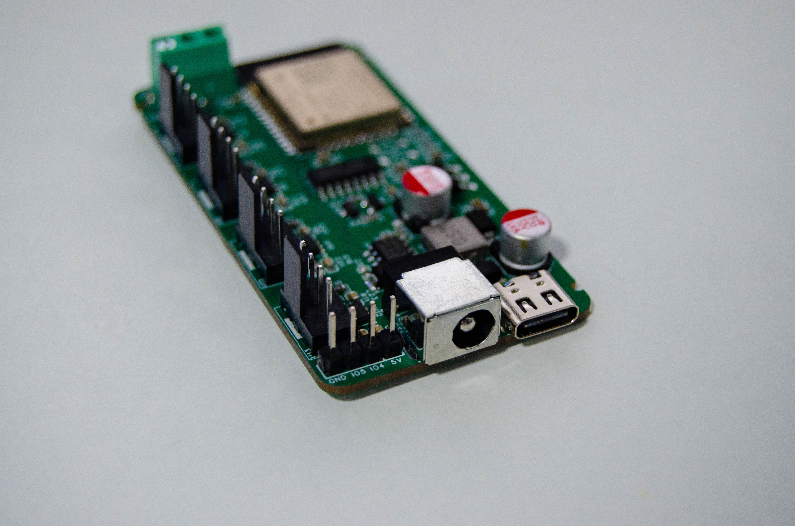

# Hardware

[← Home](Home-EN) · [中文](Hardware) · **English**



## Differences between v1.0 and v2.0

Both revisions share the same MCU and fan circuitry; v2.0 adds a 1-Wire temperature interface and a cleaner expansion header:

| Item | v1.0 | v2.0 |
|:-----|:-----|:-----|
| Fan channels | 4 × 4PIN | 4 × 4PIN |
| DC input jack | DC-044A (5.5×2.1mm) | Same |
| MCU | ESP32-WROOM-32-N4 | Same |
| USB serial | CH340C + Type-C 16PIN | Same |
| Fan power switches | 4 × TPS22810DBVR | Same |
| 3PIN part | H2: 2.54 3PIN header (1-Wire not enabled in v1.0 firmware) | U14: 3.5mm 3PIN terminal block (1-Wire / GPIO14) |
| Expansion connector | — | H1: 2.54 4PIN header (5V / GND / GPIO5 / GPIO4) |
| Temperature firmware | ❌ | ✅ DS18B20 |
| Radar firmware | ❌ | ✅ LD2402G |
| 3D-printed parts | `hardware/v1.0/3d-models/print/case.step` | `hardware/v2.0/3d-models/print/case.STEP` |

> Buying advice: go straight to **v2.0** for new builds — the hardware already reserves room for temperature and radar expansion. Cooling and fan-control capability are identical on a v1.0 board.
>
> Always trust the silkscreen on the actual board for terminal definitions; the GPIO mapping on this page and in the README comes from the firmware configuration and can be verified with a multimeter or oscilloscope.

## GPIO assignments

| GPIO | Direction | Function | Notes |
|:----:|:-----|:-----|:-----|
| GPIO16 | Output | Fan 1 PWM (LEDC 25 kHz) | Standard 4PIN fan PWM frequency |
| GPIO17 | Output | Fan 2 PWM | Same as above |
| GPIO18 | Output | Fan 3 PWM | Same as above |
| GPIO19 | Output | Fan 4 PWM | Same as above |
| GPIO32 | Input | Fan 1 tachometer (Tach) | GPIO32/33 are input-only, which fits perfectly |
| GPIO33 | Input | Fan 2 tachometer | |
| GPIO25 | Input | Fan 3 tachometer | Also a DAC pin; used as input only in this design |
| GPIO26 | Input | Fan 4 tachometer | Same as above |
| GPIO21 | Output | Fan 1 power switch (TPS22810 EN) | Shared with I²C SDA, **do not use it for I²C again** |
| GPIO22 | Output | Fan 2 power switch | Shared with I²C SCL |
| GPIO23 | Output | Fan 3 power switch | |
| GPIO13 | Output | Fan 4 power switch | |
| GPIO14 | Bidirectional | 1-Wire temperature bus (DS18B20 ×4) | Enabled in v2.0 firmware only |
| GPIO4 | Input | Radar UART RX | Radar firmware only |
| GPIO5 | Output | Radar UART TX | Radar firmware only |
| GPIO0 | Input | BOOT button | Download mode |
| EN | Input | RST button | Reset |
| GPIO1/3 | — | UART0 debug serial | Do not use |
| Spare pins | — | GPIO27, GPIO2, GPIO12, GPIO15, GPIO34/35/36/39 | 34/35/36/39 are input-only; 2/12/15 are strapping pins, pulling them low affects boot |

> Note: GPIO21/22 are taken by the power switches, so use GPIO27 + GPIO2 if you want to add I²C sensors (keep in mind that GPIO2 is a strapping pin).

## Power tree

```text
DC 12V ──┬── 4 × TPS22810 load switches ──→ 4 × fans (12V / switched independently per channel)
         │
         └── TPS5430DDAR (buck) ──→ 5V ──┬── DS18B20 / radar / headers
                                        └── AMS1117-3.3 ──→ 3.3V ──→ ESP32 / logic

USB-C 5V ──→ CH340C (serial only, not behind the load switches; cannot drive fans)
```

Current budget (12V side):

| Load | Typical | Peak |
|:-----|:-----|:-----|
| Single 120mm fan | 0.15–0.3A | 0.5A (startup inrush) |
| 4 fans | 0.6–1.2A | 2.0A |
| 5V rail (radar + probes + logic) | 0.15A | 0.3A |

→ **A 12V / 3A supply is recommended**; the surge from four fans starting simultaneously is the main constraint when choosing one. The TPS5430 is rated for 3A, but in practice keep it at or below 2A long-term.

## Key components

| Ref | Part | Function | LCSC |
|:-----|:-----|:-----|:-----|
| U4 | ESP32-WROOM-32-N4 | MCU (Wi-Fi + BLE, 4MB Flash) | C82899 |
| U1 | TPS5430DDAR | 12V → 5V buck (3A) | C9864 |
| U2 | AMS1117-3.3 | 5V → 3.3V LDO | C5250992 |
| U6/U8/U10/U12 | TPS22810DBVR ×4 | Fan power load switches (true power-off) | C205990 |
| U5 | CH340C | USB-to-serial | C84681 |
| U14 | DC-044A-A200 | 12V input DC jack | C720575 |
| USB1 | TYPE-C 16PIN 2MD | Flashing/debug port | C2765186 |
| D1–D3 | SS34 | Freewheeling / reverse protection | C8678 |
| Q4/Q6 | S8050 | CH340C auto-download circuit (EN / IO0) | C3014350 |
| U7/U9/U11/U13 | 4PIN fan headers ×4 | Standard 12V fan interface | — |
| U3 | 15µH power inductor | TPS5430 storage inductor | — |
| C1/C3–C25 | 10nF / 10µF / 100nF | Decoupling and filtering | — |
| R* | 10kΩ ×13 | TPS22810 enable, Tach pull-ups, etc. | C25804 |
| R4 (plus R15 on v2.0) | 3.24kΩ | TPS5430 feedback divider (sets the 5V output together with 10kΩ) | — |
| SW1/SW2 | TS-1088 tactile switches | RST / BOOT | C720477 |

Full BOM: [v2.0 bom.xlsx](https://github.com/YUAXI/HomeAssistant-PWM-Fan-Controlx4/blob/master/hardware/v2.0/pcb/bom.xlsx) · [v1.0 bom.xlsx](https://github.com/YUAXI/HomeAssistant-PWM-Fan-Controlx4/blob/master/hardware/v1.0/pcb/bom.xlsx)

## Fan connector (standard 4PIN)

| Pin | Signal | Controller side |
|:---:|:-----|:---------|
| 1 | GND | GND |
| 2 | +12V | Via TPS22810 to DC 12V |
| 3 | TACH (RPM feedback) | 10kΩ pull-up to 3.3V, wired to GPIO32/33/25/26 |
| 4 | PWM (open-drain/push-pull) | GPIO16–19, 25 kHz |

- 3PIN fans (no PWM wire) also work: with the PWM pin floating the fan usually runs at full speed, and the only way to control it is cutting power;
- Server-grade high-static-pressure fans draw a lot of current and have a high startup surge — mind the current headroom of the load switches and terminals;
- Fan pinouts vary between vendors, and swapping 12V/GND will **destroy hardware instantly** — always double-check before plugging in.

## How RPM is measured

Each fan revolution produces 2 pulses; the firmware counts them with `pulse_counter` (falling edge, `internal_filter: 13us` to filter out glitches, `update_interval: 4s`) and multiplies by `0.5` to get RPM:

```text
RPM ≈ (pulses in 4 s × 15) × 0.5 = pulses per minute ÷ 2
```

If the reading is clearly too low or too high, first confirm that the fan outputs 2 pulses per revolution; older fans or 3-wire fans may differ, in which case change `multiply` in the configuration.

## Mechanical parts

| File | Purpose |
|:-----|:-----|
| `3d-models/print/case.STEP` | Enclosure body (printed part) |
| `3d-models/print/top-cover.STEP` | Top cover |
| `3d-models/source/assembly.SLDASM` | SolidWorks assembly |
| `3d-models/source/case.SLDPRT` / `top-cover.SLDPRT` | SolidWorks parts |
| `3d-models/source/pcb.step` | PCB 3D model |

Printing recommendations:

| Item | Recommendation |
|:---|:-----|
| Material | PETG or ABS (rack temperatures can be high, and PLA deforms above 50°C long-term) |
| Layer height | 0.2 mm |
| Perimeters | ≥ 3 walls, 100% infill at the screw bosses |
| Supports | Needed for the fan cut-outs and terminal openings |
| Clearance | Leave 1–2 mm between fan and cut-out to avoid the blades scraping |

## Assembly and thermal design

1. Solder the power section first (TPS5430 → AMS1117); power up and verify 5V / 3.3V before soldering the ESP32 and the load switches;
2. On the first power-up leave the fans disconnected and check that all four 12V outputs (fan connector Pin2) are switched;
3. Recommended airflow is **intake at the front, exhaust at the rear**; keep all four channels in the same direction so they do not blow against each other and create recirculation;
4. Do not mount the controller against a heat source; inside a rack, place one probe at the intake and one at the hot spot;
5. Fan grilles and dust filters significantly reduce airflow — when selecting fans, assume 70% effective airflow.

## Related files

| Content | Link |
|:-----|:-----|
| v2.0 Gerber | [gerber.zip](https://github.com/YUAXI/HomeAssistant-PWM-Fan-Controlx4/blob/master/hardware/v2.0/pcb/gerber.zip) |
| v2.0 EasyEDA project | [project.epro2](https://github.com/YUAXI/HomeAssistant-PWM-Fan-Controlx4/blob/master/hardware/v2.0/pcb/project.epro2) |
| v1.0 Gerber | [gerber.zip](https://github.com/YUAXI/HomeAssistant-PWM-Fan-Controlx4/blob/master/hardware/v1.0/pcb/gerber.zip) |
| v1.0 EasyEDA project | [project.epro2](https://github.com/YUAXI/HomeAssistant-PWM-Fan-Controlx4/blob/master/hardware/v1.0/pcb/project.epro2) |
