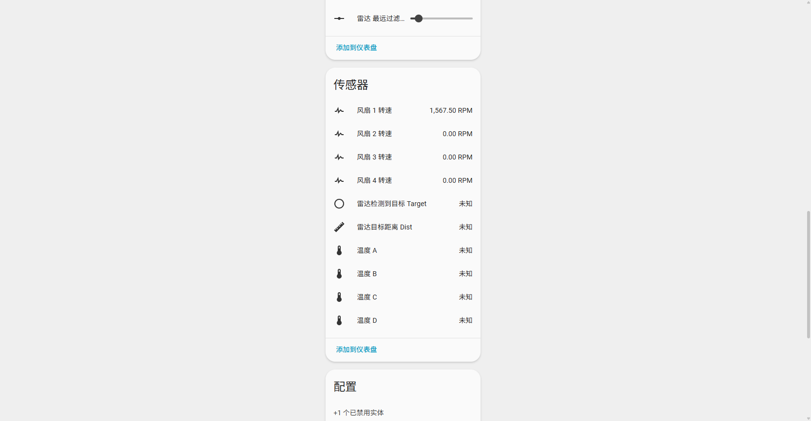

# Home Assistant Integration and Automation

[← Home](Home-EN) · [中文](Home-Assistant) · **English**

## Adding the device

1. **Settings → Devices & services → Add integration → ESPHome**.
2. Pick `ESP32 PWM 22810 xxxxxx` from the discovery list, or enter the IP manually.
3. Fill in the API encryption key:

   ```text
   LqGIGJ3qyRc+6X6hsMe5vAms+Jyh2lOMh1FQu8yyuzk=
   ```

4. When it finishes, the device page shows fans, sensors, parameter controls and diagnostic entities.

> If you rename the device or change the key in HA and then reconnect, the old entry reports an authentication failure: delete that ESPHome entry and add it again (history stays in the recorder database, so nothing is lost).



## Suggested entity tidy-up

The Chinese names in the firmware directly determine the shape of the `entity_id` (e.g. `fan.esp32_pwm_22810_a1b2c3_风扇_1`). There are two ways to tidy up:

| Approach | What you do | Impact |
|:-----|:-----|:-----|
| **Rename inside HA (recommended)** | Entity page → gear icon → change the “Entity ID” and “Name” | Takes effect immediately, no firmware change, no effect on API paths |
| Rename in the firmware | Change the YAML `name`, then recompile and flash | Creates new entities, leaves the old ones `unavailable`, and splits the history |

Suggested convention inside HA:

| Entity | Suggested entity_id |
|:-----|:---------------|
| 风扇 1–4 | `fan.rack_fan_1` … `fan.rack_fan_4` |
| Speed | `sensor.rack_fan_1_rpm` … |
| 温度 A–D | `sensor.rack_temp_a` … |
| Temperature parameters | `number.rack_fan_1_t_min` … |
| Radar | `binary_sensor.rack_presence` / `sensor.rack_presence_dist` |

> The examples below all use the placeholders `fan.fan_1`, `sensor.fan_1_rpm`, `sensor.temp_a`, `number.fan_1_t_min`, `select.fan_1_source`, `binary_sensor.radar_target` — replace them with your own entity IDs.

## Dashboard cards

### Fan control card

```yaml
type: entities
title: 机柜风扇
entities:
  - entity: fan.fan_1
  - entity: sensor.fan_1_rpm
  - entity: fan.fan_2
  - entity: sensor.fan_2_rpm
  - entity: fan.fan_3
  - entity: sensor.fan_3_rpm
  - entity: fan.fan_4
  - entity: sensor.fan_4_rpm
```

### Temperature parameters (collapsible)

```yaml
type: entities
title: 风扇 1 温控
state_color: true
entities:
  - entity: select.fan_1_source
  - type: section
    label: 温度曲线
  - entity: number.fan_1_t_min
  - entity: number.fan_1_t_max
  - entity: number.fan_1_f_min
  - entity: number.fan_1_f_max
```

### Temperature and RPM history

```yaml
type: history-graph
title: 温度 vs 转速
hours_to_show: 12
entities:
  - entity: sensor.temp_a
  - entity: sensor.fan_1_rpm
```

### RPM gauge

```yaml
type: gauge
entity: sensor.fan_1_rpm
name: 风扇 1
min: 0
max: 2000
severity:
  green: 0
  yellow: 1200
  red: 1700
```

> For prettier charts you can use the HACS cards `mini-graph-card` / `apexcharts-card`, but keep the sampling interval at 30 seconds or more to avoid bloating the recorder database.

## Temperature-control automations

### 1. Linear temperature control (v1.0 or any external temperature source)

Useful for `v1.0`, or when you want to set the speed from a HA-side sensor such as CPU temperature or a Synology drive temperature. `v2.0 DS18B20` already has a built-in local closed loop, so prefer the local one (see [temperature control](Temperature-Control-EN)).

```yaml
alias: "风扇 1：按 CPU 温度线性调速"
mode: restart
trigger:
  - platform: state
    entity_id: sensor.nas_temperature_x86_pkg_temp
  - platform: time_pattern
    minutes: "/5"
condition:
  - condition: template
    value_template: "{{ is_number(states('sensor.nas_temperature_x86_pkg_temp')) }}"
action:
  - variables:
      t: "{{ states('sensor.nas_temperature_x86_pkg_temp') | float(0) }}"
      t_min: 30
      t_max: 50
      f_min: 20
      f_max: 100
  - service: fan.set_percentage
    target:
      entity_id: fan.fan_1
    data:
      percentage: >-
         0
         {{ f_max }}
        {{ (((t - t_min) * (f_max - f_min) / (t_max - t_min)) + f_min) | round(0) | int }}
        
```

Key points:

- `time_pattern` is a safety net: it still corrects once even when the sensor has not updated for a long time;
- When the temperature is ≤ `t_min`, `0` is sent (equivalent to off for a speed fan), which gives you idle-below-threshold behaviour;
- Set `f_min` to 20 rather than 0 so low-speed starts do not stall.

### 2. Overheat protection (independent of the temperature-control logic)

```yaml
alias: "风扇：过热全速并告警"
trigger:
  - platform: numeric_state
    entity_id: sensor.temp_a
    above: 65
    for: "00:01:00"
action:
  - service: fan.set_percentage
    target: { entity_id: fan.fan_1 }
    data: { percentage: 100 }
  - service: notify.persistent_notification
    data:
      title: "机柜过热"
      message: "温度 A 已到 {{ states('sensor.temp_a') }}°C，风扇 1 已强制全速。"
```

### 3. Abnormal RPM alert

When a fan loses power or seizes, its RPM drops to 0, which makes a good failure detector:

```yaml
alias: "风扇 1 转速异常"
trigger:
  - platform: state
    entity_id: sensor.fan_1_rpm
    to: "0"
    for: "00:02:00"
condition:
  - condition: state
    entity_id: fan.fan_1
    state: "on"
action:
  - service: notify.persistent_notification
    data:
      title: "风扇 1 停转"
      message: "风扇 1 处于开启状态但转速为 0，请检查接线或风扇。"
```

### 4. Night-time quiet mode (change the parameters, not the fan)

If that channel has a temperature source bound, do not write the fan speed directly (the local closed loop overrides it after 5 seconds) — change the parameters instead:

```yaml
alias: "夜间降低风扇上限"
trigger:
  - platform: time
    at: "23:00:00"
action:
  - service: number.set_value
    target: { entity_id: number.fan_1_f_max }
    data: { value: 60 }
```

### 5. Radar integration

For presence-detection automation templates, see [mmWave radar](Radar-EN#linkage-examples).

## Scripts and scenes

```yaml
script:
  rack_fans_on:
    alias: "机柜风扇全开"
    sequence:
      - repeat:
          for_each:
            - fan.fan_1
            - fan.fan_2
            - fan.fan_3
            - fan.fan_4
          sequence:
            - service: fan.set_percentage
              target: { entity_id: "{{ repeat.item }}" }
              data: { percentage: 100 }

  rack_fans_off:
    alias: "机柜风扇全关"
    sequence:
      - service: fan.turn_off
        target:
          entity_id:
            - fan.fan_1
            - fan.fan_2
            - fan.fan_3
            - fan.fan_4
```

> Before turning everything off, remember to set the temperature source of all 4 `select` entities to `未绑定` (unbound); otherwise the local closed loop turns them back on after 5 seconds.

## Bluetooth proxy (BLE Proxy)

The firmware enables `esp32_ble_tracker` + `bluetooth_proxy`, so the device automatically becomes a Bluetooth gateway:

1. In HA go to **Settings → Devices & services**; if it does not show up automatically, add the **Bluetooth** integration;
2. The integration page will list the "ESPHome Bluetooth proxy" nodes;
3. After that, BLE thermometers, door locks and other devices can be discovered even when they are out of range of the HA host's Bluetooth.

Notes:

- Do not connect more than about 3 BLE devices to each proxy at the same time (the ESP32 shares its radio between Bluetooth and Wi-Fi);
- BLE scanning slightly increases power consumption and memory usage; if you do not need it, remove `bluetooth_proxy` from the configuration;
- The closer the device is to the BLE sensors, the better — do not bury the controller deep inside a metal rack.

## Diagnostic entities

| Entity | Purpose |
|:-----|:-----|
| 设备运行时间 | Tells you whether the device rebooted unexpectedly (an unexpected reset to zero = power loss/crash) |
| Wi-Fi 信号强度 | Better than −70 dBm is recommended; below −80 dBm packet loss becomes likely |
| 设备 IP 地址 | Check it when you reserve addresses in DHCP |
| 连接 Wi-Fi SSID | Confirms which network it joined in multi-SSID environments |
| ESPHome 版本 | Tells you whether an upgrade is needed and whether CI has updated |

## Common HA-side issues

| Symptom | Fix |
|:-----|:-----|
| Integration shows "Unable to connect" | Open `http://<IP>/` in a browser first to confirm the device is online; check firewall/VLAN isolation |
| All entities `unavailable` | The device rebooted or dropped off the network; check whether the uptime reset to zero |
| Entities appear twice (`_2`) | The device was once paired with identically named firmware; delete the old device entry and add it again |
| Automation sets the speed but it reverts after 5 seconds | That channel has a temperature source bound: set the `select` to `未绑定` (unbound), or change the parameters instead of the fan |
| History graphs are sluggish | Reduce the number of entities included in the recorder or lower the sampling frequency |
