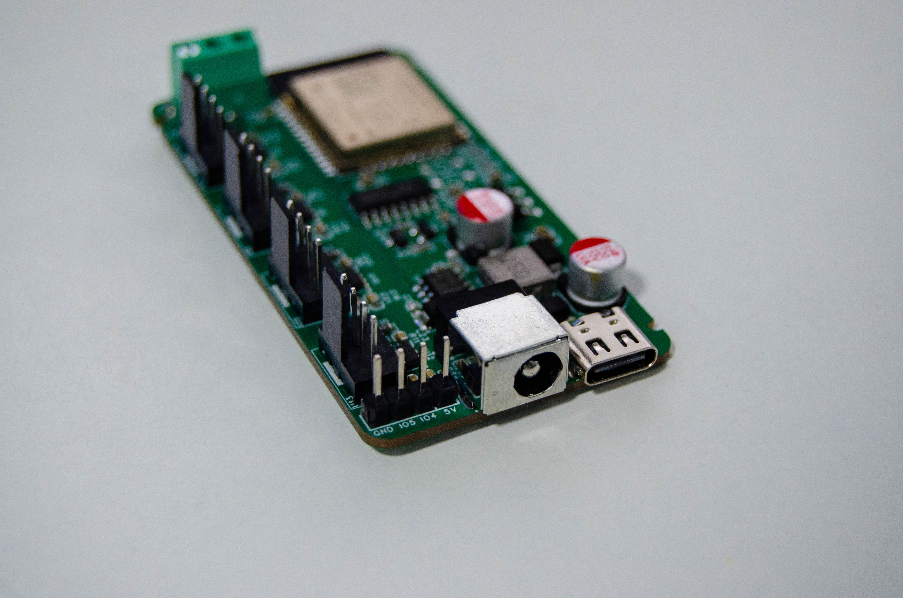
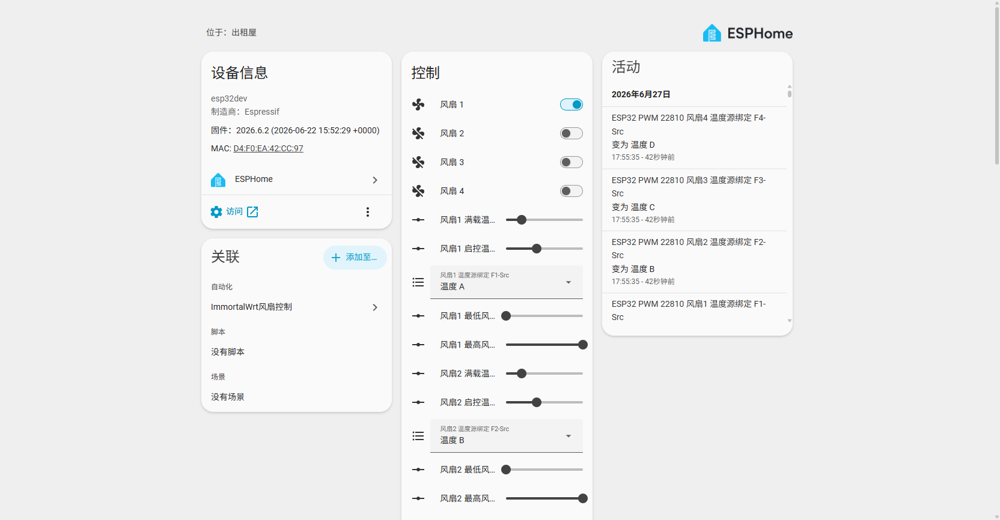

# Home · HomeAssistant-PWM-Fan-Controlx4

**English** · [中文](Home)

> An ESPHome-based 4-channel PWM fan controller: 4 independent fan channels with per-channel speed control and per-channel RPM feedback, optional DS18B20 temperature closed-loop control, optional LD2402G mmWave human presence detection, plus Home Assistant integration, a web control panel and an HTTP REST API.



## What this is

| Item | Description |
|:-----|:-----|
| Main controller | ESP32-WROOM-32-N4 (ESP-IDF framework, Wi-Fi + BLE) |
| Fan channels | 4, independent PWM (25 kHz) + independent power switch + independent RPM input |
| Speed range | 1%–100% (`speed_count: 100`), supports stopping a fan by cutting its power completely |
| Power supply | DC 12V / 2A or more (recommended); Type-C 5V only for flashing and debugging |
| Control entry points | Home Assistant (ESPHome integration), browser web panel, HTTP REST API |
| Expansion | DS18B20 1-Wire temperature bus (up to 4), LD2402G 24 GHz radar, BLE Proxy |
| Local closed loop | The v2.0 DS18B20 firmware has a built-in temperature-control algorithm, so it runs autonomously after a power cut or without network access |

## Wiki navigation

| Page | Contents |
|:-----|:-----|
| [Quick start](Getting-Started-EN) | Unboxing check, power, first-time Wi-Fi setup, firmware flashing, Home Assistant onboarding |
| [Firmware versions](Firmware-EN) | Differences between the 5 firmwares, how to choose, release artifacts, custom builds, multi-device naming |
| [Entity reference](Entities-EN) | Complete entity list (fan / RPM / temperature / parameters / diagnostics) with defaults and ranges |
| [Temperature control](Temperature-Control-EN) | DS18B20 wiring, 1-Wire index, linear speed algorithm, parameter tuning, abnormal behaviour |
| [mmWave radar](Radar-EN) | LD2402G wiring and serial protocol, anti-interference algorithm, distance-threshold tuning, automation examples |
| [HTTP API](HTTP-API-EN) | Complete REST endpoint set, Chinese entity-name encoding, curl / Python / PowerShell examples, SSE event stream |
| [Home Assistant](Home-Assistant-EN) | Adding the integration, entity polish, dashboard cards, automation templates (temperature control / silent mode / alerts) |
| [Hardware](Hardware-EN) | Full GPIO table, power tree, key components, connector silkscreen, mechanical parts and assembly notes |
| [Troubleshooting](Troubleshooting-EN) | Symptom-based diagnosis: won't boot, won't come online, fan not spinning, RPM reads 0, radar false alarms, OTA failure |
| [FAQ](FAQ-EN) | How large a fan it can drive, whether it can be modified for 24V, whether it works without HA, commercial licensing |
| [Development](Development-EN) | Repository layout, changing pins / adding channels, local builds, CI and release flow, how to contribute |
| [Changelog](Changelog-EN) | Firmware and hardware version history, behaviour changes and upgrade notes |

## One-minute quick start

```text
1. Confirm the hardware revision (single-core / dual-core) → download the matching release firmware
2. Connect Type-C to your computer and flash the .factory.bin with ESPHome Web or esptool
3. Join the ESP32-Fan-22810 hotspot from your phone → open http://192.168.4.1 to configure Wi-Fi
4. Open http://<device IP> in a browser to control it; in HA add the ESPHome integration and enter the API encryption key
```

API encryption key (the same for every firmware):

```text
LqGIGJ3qyRc+6X6hsMe5vAms+Jyh2lOMh1FQu8yyuzk=
```

## Version cheat sheet

| Firmware | Processor | Temperature | Radar | Config file |
|:-----|:------:|:----:|:----:|:---------|
| v1.0 dual-core | Dual-core | - | - | `firmware/v1.0/dual-core/config.yaml` |
| v1.0 single-core | Single-core | - | - | `firmware/v1.0/single-core/config.yaml` |
| v2.0 Basic | Single-core | - | - | `firmware/v2.0/single-core/basic/config.yaml` |
| v2.0 DS18B20 | Single-core | ✅ | - | `firmware/v2.0/single-core/ds18b20/config.yaml` |
| v2.0 DS18B20 + radar | Single-core | ✅ | ✅ | `firmware/v2.0/single-core/ds18b20-radar/config.yaml` |

> ⚠️ **Retail devices are usually single-core designs and can only run `v1.0 single-core` or any `v2.0` firmware. Flashing `v1.0 dual-core` firmware will leave the device unable to boot.**

## Key parameters

| Parameter | Value |
|:-----|:---|
| Device node name | `esp32pwm22810-<last 3 bytes of MAC>` (e.g. `esp32pwm22810-a1b2c3`) |
| HA device name | `ESP32 PWM 22810 <last 3 bytes of MAC>` |
| Hotspot SSID | `ESP32-Fan-22810` (no password, `192.168.4.1`) |
| Web panel | `http://<device IP>/` (port 80, no login) |
| mDNS | `http://esp32pwm22810-xxxxxx.local/` |
| OTA password | `4283bb50a8cd66774ce91d2c9d412cf2` |
| PWM carrier | 25 kHz |

## Related links

- [GitHub Releases (pre-built firmware)](https://github.com/YUAXI/HomeAssistant-PWM-Fan-Controlx4/releases)
- [Chinese README](https://github.com/YUAXI/HomeAssistant-PWM-Fan-Controlx4/blob/master/readme.md) · [English README](https://github.com/YUAXI/HomeAssistant-PWM-Fan-Controlx4/blob/master/README_EN.md)
- [ESPHome documentation](https://esphome.io/)
- [Home Assistant ESPHome integration](https://www.home-assistant.io/integrations/esphome/)


