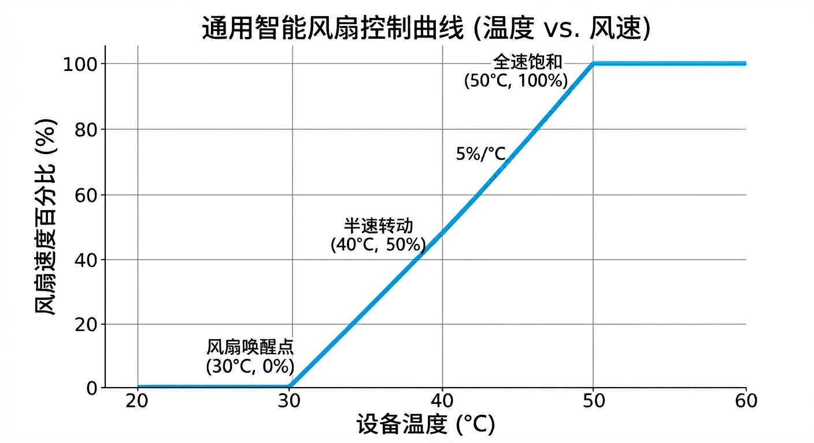

# Temperature control (DS18B20)

[← Home](Home-EN) · [中文](Temperature-Control) · **English**

Applies to the `v2.0-ds18b20` and `v2.0-ds18b20-radar` firmware. The temperature closed loop runs **on the device itself** and does not depend on Home Assistant: it keeps working with the network down or while HA is under maintenance.

## Wiring

The DS18B20 connects to the on-board **GPIO14** 1-Wire bus (v2.0 provides a 3PIN terminal block / pin header):

| DS18B20 pin | Connection |
|:------------:|:---------|
| VCC (red) | 3.3V or 5V |
| GND (black) | GND |
| DATA (yellow/white) | GPIO14 |

Key points:

- Up to **4** probes can share the bus; the firmware names them by index as **温度 A / B / C / D** (temperature A/B/C/D).
- For long cables (>1 m) or bare TO-92 probes, add a **4.7kΩ pull-up** between DATA and 3.3V; occasional `nan` readings are almost always a pull-up or contact problem.
- The bus is 3.3V logic, so even when a probe is powered from 5V its data line can still go straight to GPIO14 (the DS18B20 data pin is open-drain).
- Do not hot-plug: plugging or unplugging a probe while powered creates bus glitches that can briefly knock the other probes offline.

## Indexes and temperature A–D

The firmware works with **indexes**, not fixed addresses:

```yaml
sensor:
  - platform: dallas_temp
    index: 0        # → temperature A
    name: "温度 A"
  - platform: dallas_temp
    index: 1        # → temperature B
    ...
```

The index is decided by the 1-Wire bus enumeration order. That means:

| Situation | Result |
|:-----|:-----|
| Probe count never changes | Indexes stay stable, A–D map one-to-one to the physical probes |
| A probe is added or removed, or one drops out from bad contact | All following indexes **shift up as a whole**, so the A–D mapping changes |
| A probe is swapped | The mapping changes |

Ways around it:

1. Fit all 4 probes, fix the wiring order, and label the probes;
2. Or switch to fixed addresses (recommended for long-term deployments):

```yaml
sensor:
  - platform: dallas_temp
    address: 0x3C0000000A1B2C3D    # replace with the address of your probe
    name: "温度 A"
    update_interval: 5s
```

To find an address: set `logger.level` to `DEBUG` and the serial log prints the address of every device on the bus; or watch `esphome logs <config>`.

## Parameters

Each fan has one temperature-source binding plus 4 control parameters, adjustable straight from the HA device page / Web panel and retained across power loss:

| Parameter | Function | Range | Default |
|:-----|:-----|:-----|:----:|
| `FN-Src` 温度源绑定 | Select 未绑定 (unbound) or one of 温度 A/B/C/D | — | 风扇 1–4 → A–D |
| `T-Min` 启控温度 | At or below this temperature the fan is powered off and stops | 10–60 °C | 30 °C |
| `T-Max` 满载温度 | At or above this temperature the fan runs at `F-Max` | 40–90 °C | 50 °C |
| `F-Min` 最低风速 | Lowest speed in the linear range | 0–50 % | 0 % |
| `F-Max` 最高风速 | Highest speed in the linear range | 50–100 % | 100 % |

> The firmware does **not validate** the relationship between `T-Min` and `T-Max`. If you set `T-Min` above `T-Max`, the temperature hits the "≤ T-Min → stop" branch first and the fan **never spins**. Always keep `T-Min < T-Max`.

## Algorithm

The control loop runs every **5 seconds** (`interval: 5s`), with logic identical to the firmware source:

```text
current temp = NaN (probe missing / read failed)  → keep current speed and on/off state, do nothing
current temp ≤ T-Min                              → cut power, stop completely (set_state(false))
current temp ≥ T-Max                              → turn on and run at F-Max
T-Min < current temp < T-Max                      → linear interpolation:
      pct = (T - T-Min) × (F-Max - F-Min) ÷ (T-Max - T-Min) + F-Min
      round, then set_state(true) + set_speed(pct)
```

The matching firmware implementation:

```cpp
auto calculate_speed = [](float current_t, float t_min, float t_max, float f_min, float f_max) -> int {
  if (std::isnan(current_t)) return -1;      // sensor failure → keep the current state
  if (current_t <= t_min) return -2;         // below the trigger temperature → power the fan off
  if (current_t >= t_max) return (int)f_max; // at or above the full-speed temperature → maximum speed
  float pct = ((current_t - t_min) * (f_max - f_min) / (t_max - t_min) + f_min);
  return (int)roundf(pct);
};
```

Full behaviour table:

| Temperature | Source = 未绑定 | Source bound, reading valid | Source bound, reading `nan` |
|:-----|:-------------|:----------------------|:---------------------------|
| ≤ T-Min | No intervention | Powered off, stopped | Keep current state |
| Middle range | No intervention | Linear speed control | Keep current state |
| ≥ T-Max | No intervention | Runs at `F-Max` | Keep current state |



## A common pitfall: `F-Min = 0`

`F-Min` defaults to 0. When the temperature is only slightly above `T-Min`, the computed value rounds to **0**, and `set_speed(0)` is equivalent to turning the fan off — so it looks like "the temperature crossed the line but the fan still does not spin".

Set `F-Min` to the smallest duty cycle at which that fan **starts reliably** (20–30% for most 12V fans). That avoids failed start-ups and also reduces low-speed resonance noise.

## Manual control vs. local closed loop

> **Once a temperature source is bound, the local closed loop overwrites the fan state every 5 seconds.** A speed set by hand in HA / Web / the API is reverted 5 seconds later.

To control a fan manually, set its `FN-Src` to **未绑定** (unbound). This is the most common switch besides the default behaviour.

## Tuning examples

| Scenario | T-Min | T-Max | F-Min | F-Max | Effect |
|:-----|:-----:|:-----:|:-----:|:-----:|:-----|
| NAS quiet (drives 32–48°C) | 32 | 48 | 20 | 70 | Fully silent when cool, low speed day to day |
| Server rack (intake air 28–45°C) | 28 | 45 | 30 | 100 | Fast response, strong full-load cooling |
| Office quiet (27–40°C) | 27 | 40 | 25 | 60 | 60% ceiling keeps noise down |
| Safety first (rather loud than hot) | 26 | 40 | 40 | 100 | Starts at 40% the moment it spins |

Tuning tips:

1. Run a **start-up test** on each fan first: try 1%, 5%, 10% and 20% manually, note the lowest value that gets it spinning → use that as `F-Min`;
2. Keep `T-Max` away from the device's alarm temperature, with 5–10°C of margin;
3. With a 5 s control period plus a 5 s probe refresh, the worst-case response is about 10 s — not suitable for heat sources that swing by the second;
4. When four fans share one temperature source, stagger their `T-Min` by 2–3°C to avoid the noise and current inrush of all four starting and stopping together.

## Debugging

| Symptom | Check first |
|:-----|:-----|
| Temperature shows `unknown` | Is the probe on GPIO14, is there a 4.7k pull-up, are all 4 probes online |
| Temperature is fine but the fan does not move | Is `FN-Src` bound to the right temperature, is `T-Min` above the current temperature, is `F-Min` 0 |
| Fan speed jumps around | `F-Min` too low, causing repeated start/stop; raise `F-Min` above the start-up threshold |
| Temperature A–D do not match | Index order changed; switch to a fixed `address` |
| Want to watch the algorithm | Expand the log in the Web panel, or use `esphome logs` to see each 5 s speed decision |

## Local closed loop vs. HA automations

| Dimension | Local closed loop (v2.0 DS18B20) | HA automation (all versions) |
|:-----|:------------------------|:----------------------|
| Works offline | ✅ | ❌ |
| Temperature source | Onboard DS18B20 only | Any HA entity (CPU, Synology, Zigbee sensors…) |
| Logic complexity | Linear model + 5 parameters | Arbitrary templates, schedules, conditions, notifications |
| Response speed | 5–10 s | Depends on trigger frequency, usually faster |
| Maintenance | No HA-side configuration | Automations must be maintained |

The two can coexist, but do not drive the same fan from both at once — an HA automation's change is overridden by the local closed loop within 5 seconds. Recommended: let the local closed loop handle baseline cooling, and use HA only for "mode switching" (changing the `T-Min` / `F-Max` parameters) and notification alerts, see [Home Assistant](Home-Assistant-EN#temperature-control-automations).
