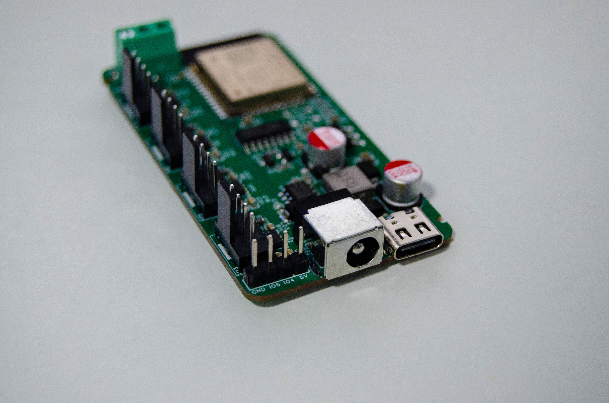

# 硬件资料

[← 首页](Home) · **中文** · [English](Hardware-EN)



## v1.0 与 v2.0 的差异

两版共用同一套主控与风扇电路，v2.0 增加了 1-Wire 温度接口与更规范的扩展排针：

| 项目 | v1.0 | v2.0 |
|:-----|:-----|:-----|
| 风扇通道 | 4 × 4PIN | 4 × 4PIN |
| DC 输入座 | DC-044A（5.5×2.1mm） | 同 |
| 主控 | ESP32-WROOM-32-N4 | 同 |
| USB 串口 | CH340C + Type-C 16PIN | 同 |
| 风扇电源开关 | 4 × TPS22810DBVR | 同 |
| 3PIN 器件 | H2：2.54 3PIN 排针（v1.0 固件未启用 1-Wire） | U14：3.5mm 3PIN 接线端子（1-Wire / GPIO14） |
| 扩展接口 | — | H1：2.54 4PIN 排针（5V / GND / GPIO5 / GPIO4） |
| 温度固件 | ❌ | ✅ DS18B20 |
| 雷达固件 | ❌ | ✅ LD2402G |
| 3D 打印件 | `hardware/v1.0/3d-models/print/case.step` | `hardware/v2.0/3d-models/print/case.STEP` |

> 选型建议：新装机直接上 **v2.0**，硬件预留了温度与雷达扩展；v1.0 板子的散热与风扇控制能力完全相同。
>
> 具体端子定义以实物丝印为准；本页与 README 中的 GPIO 映射来自固件配置，可用万用表/示波器复核。

## GPIO 分配

| GPIO | 方向 | 功能 | 备注 |
|:----:|:-----|:-----|:-----|
| GPIO16 | 输出 | 风扇 1 PWM（LEDC 25 kHz） | 标准 4PIN 风扇 PWM 频率 |
| GPIO17 | 输出 | 风扇 2 PWM | 同上 |
| GPIO18 | 输出 | 风扇 3 PWM | 同上 |
| GPIO19 | 输出 | 风扇 4 PWM | 同上 |
| GPIO32 | 输入 | 风扇 1 转速（Tach） | GPIO32/33 只支持输入，正合适 |
| GPIO33 | 输入 | 风扇 2 转速 | |
| GPIO25 | 输入 | 风扇 3 转速 | 也是 DAC 脚，本设计只做输入 |
| GPIO26 | 输入 | 风扇 4 转速 | 同上 |
| GPIO21 | 输出 | 风扇 1 电源开关（TPS22810 EN） | 与 I²C SDA 复用脚，**不要再用作 I²C** |
| GPIO22 | 输出 | 风扇 2 电源开关 | 与 I²C SCL 复用脚 |
| GPIO23 | 输出 | 风扇 3 电源开关 | |
| GPIO13 | 输出 | 风扇 4 电源开关 | |
| GPIO14 | 双向 | 1-Wire 温度总线（DS18B20 ×4） | 仅 v2.0 固件启用 |
| GPIO4 | 输入 | 雷达 UART RX | 仅雷达固件 |
| GPIO5 | 输出 | 雷达 UART TX | 仅雷达固件 |
| GPIO0 | 输入 | BOOT 按键 | 下载模式 |
| EN | 输入 | RST 按键 | 复位 |
| GPIO1/3 | — | UART0 调试串口 | 不要占用 |
| 可用余量 | — | GPIO27、GPIO2、GPIO12、GPIO15、GPIO34/35/36/39 | 34/35/36/39 只能输入；2/12/15 是启动脚，拉低会影响启动 |

> 注：GPIO21/22 被电源开关占用，所以想加 I²C 传感器请用 GPIO27 + GPIO2（注意 GPIO2 是启动脚）。

## 电源树

```text
DC 12V ──┬── 4 × TPS22810 负载开关 ──→ 4 × 风扇（12V / 每路独立开关）
         │
         └── TPS5430DDAR（降压）──→ 5V ──┬── DS18B20 / 雷达 / 排针
                                        └── AMS1117-3.3 ──→ 3.3V ──→ ESP32 / 逻辑

USB-C 5V ──→ CH340C（仅串口，不经负载开关；不能驱动风扇）
```

电流预算（12V 侧）：

| 负载 | 典型 | 峰值 |
|:-----|:-----|:-----|
| 单个 120mm 风扇 | 0.15–0.3 A | 0.5 A（启动瞬间） |
| 4 路风扇 | 0.6–1.2 A | 2.0 A |
| 5V 轨（雷达 + 探头 + 逻辑） | 0.15 A | 0.3 A |

→ **推荐 12V / 3A 电源**；4 路同时启动的浪涌是选电源的主要约束。TPS5430 额定 3A，实际建议长期不超过 2A。

## 关键器件

| 位号 | 器件 | 作用 | LCSC |
|:-----|:-----|:-----|:-----|
| U4 | ESP32-WROOM-32-N4 | 主控（Wi-Fi + BLE，4MB Flash） | C82899 |
| U1 | TPS5430DDAR | 12V → 5V 降压（3A） | C9864 |
| U2 | AMS1117-3.3 | 5V → 3.3V LDO | C5250992 |
| U6/U8/U10/U12 | TPS22810DBVR ×4 | 风扇电源负载开关（真正断电） | C205990 |
| U5 | CH340C | USB 转串口 | C84681 |
| U14 | DC-044A-A200 | 12V 输入 DC 座 | C720575 |
| USB1 | TYPE-C 16PIN 2MD | 刷写/调试口 | C2765186 |
| D1–D3 | SS34 | 续流/防反 | C8678 |
| Q4/Q6 | S8050 | CH340C 自动下载电路（EN / IO0） | C3014350 |
| U7/U9/U11/U13 | 4PIN 风扇座 ×4 | 标准 12V 风扇接口 | — |
| U3 | 15µH 功率电感 | TPS5430 储能电感 | — |
| C1/C3–C25 | 10nF / 10µF / 100nF | 去耦与滤波 | — |
| R* | 10kΩ ×13 | TPS22810 使能、Tach 上拉等 | C25804 |
| R4（v2.0 另有 R15） | 3.24kΩ | TPS5430 反馈分压（与 10kΩ 一起设定 5V 输出） | — |
| SW1/SW2 | TS-1088 轻触按键 | RST / BOOT | C720477 |

完整 BOM：[v2.0 bom.xlsx](https://github.com/YUAXI/HomeAssistant-PWM-Fan-Controlx4/blob/master/hardware/v2.0/pcb/bom.xlsx) · [v1.0 bom.xlsx](https://github.com/YUAXI/HomeAssistant-PWM-Fan-Controlx4/blob/master/hardware/v1.0/pcb/bom.xlsx)

## 风扇接口（标准 4PIN）

| Pin | 信号 | 控制器侧 |
|:---:|:-----|:---------|
| 1 | GND | GND |
| 2 | +12V | 经 TPS22810 到 DC 12V |
| 3 | TACH（转速反馈） | 10kΩ 上拉到 3.3V，接 GPIO32/33/25/26 |
| 4 | PWM（开漏/推挽） | GPIO16–19，25 kHz |

- 3PIN 风扇（无 PWM 线）也能接：PWM 脚悬空时风扇通常全速运行，调速只能靠断电；
- 服务器的暴力风扇电流大、启动浪涌高，注意负载开关与端子的电流余量；
- 风扇线序各家可能不同，接反 12V/GND 会**瞬间烧毁**，上机前务必核对。

## 转速测量原理

风扇每转输出 2 个脉冲，固件用 `pulse_counter`（下降沿、`internal_filter: 13us` 滤掉毛刺、`update_interval: 4s`）统计后乘 `0.5` 得到 RPM：

```text
RPM ≈ (4 秒内脉冲数 × 15) × 0.5 = 每分钟脉冲数 ÷ 2
```

若读数明显偏低/偏高，先确认风扇是 2 脉冲/转；老式风扇或 3 线风扇可能不同，可改配置里的 `multiply`。

## 结构件

| 文件 | 用途 |
|:-----|:-----|
| `3d-models/print/case.STEP` | 外壳主体（打印件） |
| `3d-models/print/top-cover.STEP` | 上盖 |
| `3d-models/source/assembly.SLDASM` | SolidWorks 装配体 |
| `3d-models/source/case.SLDPRT` / `top-cover.SLDPRT` | SolidWorks 零件 |
| `3d-models/source/pcb.step` | PCB 3D 模型 |

打印建议：

| 项 | 建议 |
|:---|:-----|
| 材料 | PETG 或 ABS（机柜内温度可能偏高，PLA 长期 >50°C 会变形） |
| 层高 | 0.2 mm |
| 墙数 | ≥ 3 层墙，螺丝柱位置 100% 填充 |
| 支撑 | 风扇开孔与端子开口需要支撑 |
| 间隙 | 风扇与开孔留 1–2 mm，避免风叶扫边 |

## 装配与热设计

1. 先焊电源部分（TPS5430 → AMS1117），上电测 5V / 3.3V 正常后再焊 ESP32 与负载开关；
2. 首次上电不接风扇，量 4 路 12V 输出（风扇座 Pin2）是否受控；
3. 风扇推荐**前部进风、后部出风**，4 路尽量同向，避免对吹形成回流；
4. 控制器不要贴着发热源；机柜内建议把探头放在进风口与热点各一个；
5. 风扇网罩/防尘网会显著降低风量，选型时按 70% 有效风量估算。

## 相关文件

| 内容 | 链接 |
|:-----|:-----|
| v2.0 Gerber | [gerber.zip](https://github.com/YUAXI/HomeAssistant-PWM-Fan-Controlx4/blob/master/hardware/v2.0/pcb/gerber.zip) |
| v2.0 立创 EDA 工程 | [project.epro2](https://github.com/YUAXI/HomeAssistant-PWM-Fan-Controlx4/blob/master/hardware/v2.0/pcb/project.epro2) |
| v1.0 Gerber | [gerber.zip](https://github.com/YUAXI/HomeAssistant-PWM-Fan-Controlx4/blob/master/hardware/v1.0/pcb/gerber.zip) |
| v1.0 立创 EDA 工程 | [project.epro2](https://github.com/YUAXI/HomeAssistant-PWM-Fan-Controlx4/blob/master/hardware/v1.0/pcb/project.epro2) |
