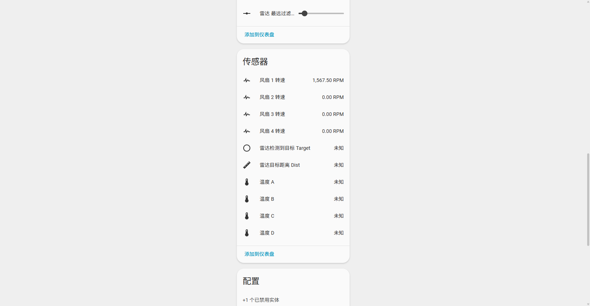

# Home Assistant 集成与自动化

[← 首页](Home) · **中文** · [English](Home-Assistant-EN)

## 添加设备

1. **设置 → 设备与服务 → 添加集成 → ESPHome**。
2. 自动发现列表里选 `ESP32 PWM 22810 xxxxxx`，或手动输入 IP。
3. 填 API 加密密钥：

   ```text
   LqGIGJ3qyRc+6X6hsMe5vAms+Jyh2lOMh1FQu8yyuzk=
   ```

4. 完成后设备页会出现风扇、传感器、参数控件和诊断实体。

> 若在 HA 里改名/改密钥后重连，旧条目会报认证失败：删除该 ESPHome 条目再重新添加即可（历史数据会留在 recorder 数据库中，不影响）。



## 建议的实体整理

固件里的中文名直接决定了 `entity_id` 的形态（如 `fan.esp32_pwm_22810_a1b2c3_风扇_1`）。两种整理方式：

| 方式 | 操作 | 影响 |
|:-----|:-----|:-----|
| **HA 内重命名（推荐）** | 实体页 → 齿轮 → 改「实体 ID」与「名称」 | 立即生效，不改固件，不影响 API 路径 |
| 固件内改名 | 改 YAML `name` 后重新编译刷写 | 会新增实体并把旧实体变 `unavailable`，历史数据断开 |

HA 内建议统一成：

| 实体 | 建议 entity_id |
|:-----|:---------------|
| 风扇 1–4 | `fan.rack_fan_1` … `fan.rack_fan_4` |
| 转速 | `sensor.rack_fan_1_rpm` … |
| 温度 A–D | `sensor.rack_temp_a` … |
| 温控参数 | `number.rack_fan_1_t_min` … |
| 雷达 | `binary_sensor.rack_presence` / `sensor.rack_presence_dist` |

> 下文示例统一用占位名 `fan.fan_1`、`sensor.fan_1_rpm`、`sensor.temp_a`、`number.fan_1_t_min`、`select.fan_1_source`、`binary_sensor.radar_target`，请替换成你自己的实体 ID。

## 仪表板卡片

### 风扇控制卡片

```yaml
type: entities
title: 机柜风扇
entities:
  - entity: fan.fan_1
  - entity: sensor.fan_1_rpm
  - entity: fan.fan_2
  - entity: sensor.fan_2_rpm
  - entity: fan.fan_3
  - entity: sensor.fan_3_rpm
  - entity: fan.fan_4
  - entity: sensor.fan_4_rpm
```

### 温控参数（可折叠）

```yaml
type: entities
title: 风扇 1 温控
state_color: true
entities:
  - entity: select.fan_1_source
  - type: section
    label: 温度曲线
  - entity: number.fan_1_t_min
  - entity: number.fan_1_t_max
  - entity: number.fan_1_f_min
  - entity: number.fan_1_f_max
```

### 温度与转速趋势

```yaml
type: history-graph
title: 温度 vs 转速
hours_to_show: 12
entities:
  - entity: sensor.temp_a
  - entity: sensor.fan_1_rpm
```

### 转速仪表

```yaml
type: gauge
entity: sensor.fan_1_rpm
name: 风扇 1
min: 0
max: 2000
severity:
  green: 0
  yellow: 1200
  red: 1700
```

> 想要更漂亮的曲线可以用 HACS 的 `mini-graph-card` / `apexcharts-card`，但请把采样间隔设在 30 秒以上，避免 recorder 数据库膨胀。

## 温控相关自动化

### 1. 线性温控（v1.0 或任意外部温度源）

适用于 `v1.0`，或想用 CPU 温度、群晖温度等 HA 侧传感器控速的场景。`v2.0 DS18B20` 已内置本地闭环，优先用本地（见 [温度控制](Temperature-Control)）。

```yaml
alias: "风扇 1：按 CPU 温度线性调速"
mode: restart
trigger:
  - platform: state
    entity_id: sensor.nas_temperature_x86_pkg_temp
  - platform: time_pattern
    minutes: "/5"
condition:
  - condition: template
    value_template: "{{ is_number(states('sensor.nas_temperature_x86_pkg_temp')) }}"
action:
  - variables:
      t: "{{ states('sensor.nas_temperature_x86_pkg_temp') | float(0) }}"
      t_min: 30
      t_max: 50
      f_min: 20
      f_max: 100
  - service: fan.set_percentage
    target:
      entity_id: fan.fan_1
    data:
      percentage: >-
         0
         {{ f_max }}
        {{ (((t - t_min) * (f_max - f_min) / (t_max - t_min)) + f_min) | round(0) | int }}
        
```

要点：

- `time_pattern` 兜底：传感器长时间不更新时也能校正一次；
- 温度 ≤ `t_min` 时下发 `0`（对 speed fan 等价关闭），实现低温停转；
- `f_min` 设 20 而不是 0，避免低速档起转失败。

### 2. 过热保护（独立于温控逻辑）

```yaml
alias: "风扇：过热全速并告警"
trigger:
  - platform: numeric_state
    entity_id: sensor.temp_a
    above: 65
    for: "00:01:00"
action:
  - service: fan.set_percentage
    target: { entity_id: fan.fan_1 }
    data: { percentage: 100 }
  - service: notify.persistent_notification
    data:
      title: "机柜过热"
      message: "温度 A 已到 {{ states('sensor.temp_a') }}°C，风扇 1 已强制全速。"
```

### 3. 转速异常告警

风扇断电或卡死时转速会掉到 0，可以拿来当故障检测：

```yaml
alias: "风扇 1 转速异常"
trigger:
  - platform: state
    entity_id: sensor.fan_1_rpm
    to: "0"
    for: "00:02:00"
condition:
  - condition: state
    entity_id: fan.fan_1
    state: "on"
action:
  - service: notify.persistent_notification
    data:
      title: "风扇 1 停转"
      message: "风扇 1 处于开启状态但转速为 0，请检查接线或风扇。"
```

### 4. 夜间静音（改参数而不是改风扇）

若该路绑定了温度源，别直接写风扇速度（5 秒后会被本地闭环覆盖），改参数才对：

```yaml
alias: "夜间降低风扇上限"
trigger:
  - platform: time
    at: "23:00:00"
action:
  - service: number.set_value
    target: { entity_id: number.fan_1_f_max }
    data: { value: 60 }
```

### 5. 雷达联动

人体存在检测的联动模板见 [毫米波雷达](Radar#联动示例)。

## 脚本与场景

```yaml
script:
  rack_fans_on:
    alias: "机柜风扇全开"
    sequence:
      - repeat:
          for_each:
            - fan.fan_1
            - fan.fan_2
            - fan.fan_3
            - fan.fan_4
          sequence:
            - service: fan.set_percentage
              target: { entity_id: "{{ repeat.item }}" }
              data: { percentage: 100 }

  rack_fans_off:
    alias: "机柜风扇全关"
    sequence:
      - service: fan.turn_off
        target:
          entity_id:
            - fan.fan_1
            - fan.fan_2
            - fan.fan_3
            - fan.fan_4
```

> 全关前记得把 4 路 `select` 温度源设为「未绑定」，否则 5 秒后本地闭环会把它们重新打开。

## 蓝牙代理（BLE Proxy）

固件启用了 `esp32_ble_tracker` + `bluetooth_proxy`，设备会自动变成一个蓝牙网关：

1. HA 中 **设置 → 设备与服务**，若未自动出现，添加 **Bluetooth** 集成；
2. 集成页面会列出「ESPHome 蓝牙代理」节点；
3. 之后 BLE 温湿度计、门锁等设备即使超出 HA 主机蓝牙范围也能被发现。

注意：

- 每个代理同时连接的 BLE 设备不宜超过 3 个（ESP32 蓝牙与 Wi-Fi 共享射频）；
- BLE 扫描会略微增加功耗和内存占用，不用时可以在配置里去掉 `bluetooth_proxy`；
- 设备离 BLE 传感器越近效果越好，别把控制器塞进金属机柜深处。

## 诊断实体

| 实体 | 用途 |
|:-----|:-----|
| 设备运行时间 | 判断是否意外重启（数值异常归零 = 掉电/崩溃） |
| Wi-Fi 信号强度 | 建议优于 −70 dBm；低于 −80 dBm 容易丢包 |
| 设备 IP 地址 | DHCP 保留地址时核对 |
| 连接 Wi-Fi SSID | 多 SSID 环境下确认连的是哪个 |
| ESPHome 版本 | 判断是否需要升级、CI 是否已更新 |

## 常见 HA 侧问题

| 现象 | 处理 |
|:-----|:-----|
| 集成显示「无法连接」 | 浏览器先访问 `http://<IP>/` 确认设备在线；检查防火墙/网段隔离 |
| 实体全部 `unavailable` | 设备重启或断网；看运行时间是否归零 |
| 实体重复出现（`_2`） | 曾经用同名固件接入过，删除旧设备条目后重新添加 |
| 自动化改了速度但 5 秒后变回去 | 该路绑定了温度源，改 `select` 为「未绑定」，或改参数而不是风扇 |
| 历史曲线很卡 | 降低 recorder 包含的实体数量或采样频率 |
