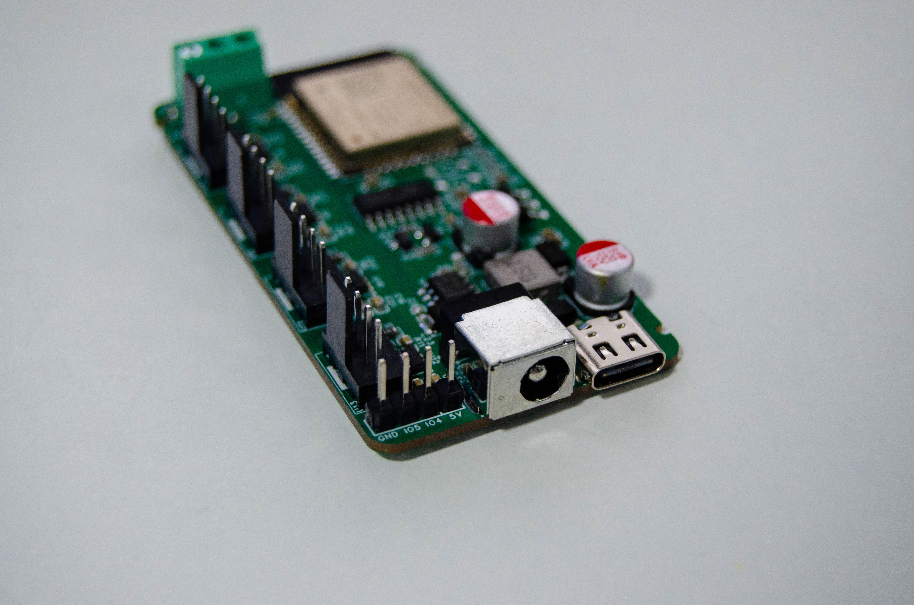
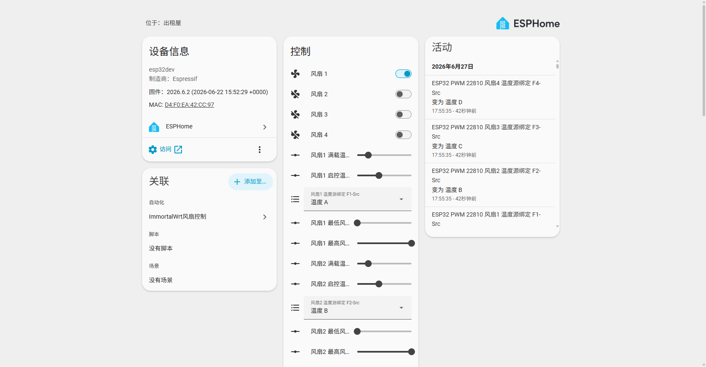

# 首页 · HomeAssistant-PWM-Fan-Controlx4

**中文** · [English](Home-EN)

> 一个基于 ESPHome 的 4 路 PWM 风扇控制器：4 路独立调速、4 路转速回读、可选 DS18B20 温度闭环、可选 LD2402G 毫米波人体存在检测，同时提供 Home Assistant 集成、Web 控制面板和 HTTP REST API。



## 这是什么

| 项目 | 说明 |
|:-----|:-----|
| 主控 | ESP32-WROOM-32-N4（ESP-IDF 框架，Wi-Fi + BLE） |
| 风扇通道 | 4 路，独立 PWM（25 kHz）+ 独立电源开关 + 独立转速输入 |
| 调速范围 | 1%–100%（`speed_count: 100`），支持完全断电停转 |
| 供电 | DC 12V / 2A 以上（推荐）；Type-C 5V 仅用于刷写调试 |
| 控制入口 | Home Assistant（ESPHome 集成）、浏览器 Web 面板、HTTP REST API |
| 扩展能力 | DS18B20 1-Wire 温度总线（最多 4 路）、LD2402G 24GHz 雷达、BLE Proxy |
| 本地闭环 | v2.0 DS18B20 固件内置温控算法，断电断网也能独立运行 |

## Wiki 导航

| 页面 | 内容 |
|:-----|:-----|
| [快速上手](Getting-Started) | 开箱检查、供电、首次配网、刷写固件、接入 Home Assistant |
| [固件版本](Firmware) | 5 个固件的差异、选型决策、Release 产物、自定义编译、多设备命名 |
| [实体参考](Entities) | 全部实体清单（风扇 / 转速 / 温度 / 参数 / 诊断）与默认值、取值范围 |
| [温度控制](Temperature-Control) | DS18B20 接线、1-Wire 索引、线性调速算法、参数调优、异常行为 |
| [毫米波雷达](Radar) | LD2402G 接线与串口协议、抗干扰算法、距离门限调参、联动示例 |
| [HTTP API](HTTP-API) | REST 端点全集、中文实体名编码、curl / Python / PowerShell 示例、SSE 事件流 |
| [Home Assistant](Home-Assistant) | 集成添加、实体美化、仪表板卡片、自动化模板（温控 / 静音 / 告警） |
| [硬件资料](Hardware) | GPIO 全表、电源树、关键器件、接口丝印、结构件与装配要点 |
| [故障排查](Troubleshooting) | 按症状定位：不启动、不上线、风扇不转、转速为 0、雷达误报、OTA 失败 |
| [常见问题](FAQ) | 能带多大风扇、能不能改 24V、能不能不用 HA、商用授权等 |
| [开发指南](Development) | 仓库结构、改引脚 / 加通道、本地编译、CI 与发布流程、贡献方式 |
| [更新记录](Changelog) | 固件与硬件的版本演进、行为变更与升级注意事项 |

## 一分钟上手

```text
1. 确认硬件版本（单核 / 双核）→ 下载对应 Release 固件
2. Type-C 连电脑，用 ESPHome Web 或 esptool 刷 .factory.bin
3. 手机连热点 ESP32-Fan-22810 → 打开 http://192.168.4.1 配网
4. 浏览器打开 http://<设备IP> 即可控制；HA 中添加 ESPHome 集成并填入 API 加密密钥
```

API 加密密钥（所有固件同一把）：

```text
LqGIGJ3qyRc+6X6hsMe5vAms+Jyh2lOMh1FQu8yyuzk=
```

## 版本速查

| 固件 | 处理器 | 温度 | 雷达 | 配置文件 |
|:-----|:------:|:----:|:----:|:---------|
| v1.0 双核 | 双核 | - | - | `firmware/v1.0/dual-core/config.yaml` |
| v1.0 单核 | 单核 | - | - | `firmware/v1.0/single-core/config.yaml` |
| v2.0 Basic | 单核 | - | - | `firmware/v2.0/single-core/basic/config.yaml` |
| v2.0 DS18B20 | 单核 | ✅ | - | `firmware/v2.0/single-core/ds18b20/config.yaml` |
| v2.0 DS18B20+雷达 | 单核 | ✅ | ✅ | `firmware/v2.0/single-core/ds18b20-radar/config.yaml` |

> ⚠️ **成品设备通常是单核设计，只能刷 `v1.0 单核` 或任意 `v2.0` 固件。刷入 `v1.0 双核` 固件会导致设备无法启动。**

## 关键参数

| 参数 | 值 |
|:-----|:---|
| 设备节点名 | `esp32pwm22810-<MAC 后 3 字节>`（如 `esp32pwm22810-a1b2c3`） |
| HA 设备名 | `ESP32 PWM 22810 <MAC 后 3 字节>` |
| 热点 SSID | `ESP32-Fan-22810`（无密码，`192.168.4.1`） |
| Web 面板 | `http://<设备IP>/`（80 端口，无需登录） |
| mDNS | `http://esp32pwm22810-xxxxxx.local/` |
| OTA 密码 | `4283bb50a8cd66774ce91d2c9d412cf2` |
| PWM 载波 | 25 kHz |

## 相关链接

- [GitHub Releases（预编译固件）](https://github.com/YUAXI/HomeAssistant-PWM-Fan-Controlx4/releases)
- [中文 README](https://github.com/YUAXI/HomeAssistant-PWM-Fan-Controlx4/blob/master/readme.md) · [English README](https://github.com/YUAXI/HomeAssistant-PWM-Fan-Controlx4/blob/master/README_EN.md)
- [ESPHome 官方文档](https://esphome.io/)
- [Home Assistant ESPHome 集成](https://www.home-assistant.io/integrations/esphome/)


