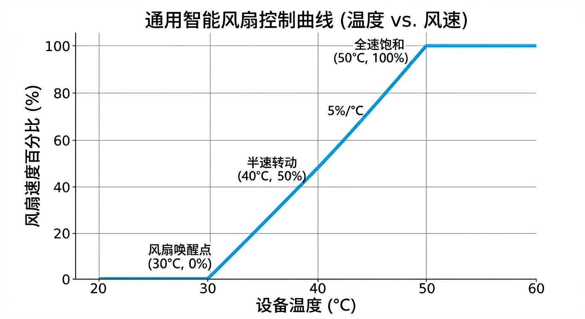

# 温度控制（DS18B20）

[← 首页](Home) · **中文** · [English](Temperature-Control-EN)

适用于 `v2.0-ds18b20` 与 `v2.0-ds18b20-radar` 固件。温度闭环在**设备本地**运行，不依赖 Home Assistant：断网、HA 维护期间依然有效。

## 接线

DS18B20 接到板载 **GPIO14** 的 1-Wire 总线（v2.0 为 3PIN 接线端子/排针）：

| DS18B20 引脚 | 连接位置 |
|:------------:|:---------|
| VCC（红） | 3.3V 或 5V |
| GND（黑） | GND |
| DATA（黄/白） | GPIO14 |

要点：

- 单总线最多并联 **4** 个探头，固件按索引命名为 **温度 A / B / C / D**。
- 长线（>1m）或裸 TO-92 探头建议在 DATA 与 3.3V 之间加 **4.7kΩ 上拉**；读数偶发 `nan` 基本都是上拉/接触问题。
- 总线是 3.3V 逻辑，探头用 5V 供电时数据线仍可直接接 GPIO14（DS18B20 数据脚为开漏输出）。
- 不要热插拔：带电插拔会造成总线毛刺，可能让另外几个探头短暂掉线。

## 索引与「温度 A–D」

固件用的是**索引**而不是固定地址：

```yaml
sensor:
  - platform: dallas_temp
    index: 0        # → 温度 A
    name: "温度 A"
  - platform: dallas_temp
    index: 1        # → 温度 B
    ...
```

索引由 1-Wire 总线枚举顺序决定。这意味着：

| 情况 | 结果 |
|:-----|:-----|
| 探头数量固定不动 | 索引稳定，A–D 与物理探头一一对应 |
| 增减探头、或某个探头接触不良掉线 | 后续索引**整体前移**，A–D 与探头对应关系会变 |
| 换探头 | 对应关系变 |

规避办法：

1. 接满 4 个探头并固定线序，在探头上贴标签；
2. 或改用固定地址（推荐长期部署）：

```yaml
sensor:
  - platform: dallas_temp
    address: 0x3C0000000A1B2C3D    # 换成你的探头地址
    name: "温度 A"
    update_interval: 5s
```

查地址：把 `logger.level` 改为 `DEBUG`，串口日志会打印总线上每个器件的地址；或用 `esphome logs <config>` 观察。

## 参数

每路风扇有 1 个温度源绑定和 4 个温控参数，在 HA 设备页 / Web 面板直接调，掉电保持：

| 参数 | 作用 | 范围 | 默认 |
|:-----|:-----|:-----|:----:|
| `FN-Src` 温度源绑定 | 选择未绑定或温度 A/B/C/D | — | 风扇 1–4 → A–D |
| `T-Min` 启控温度 | 温度 ≤ 该值时断电停转 | 10–60 °C | 30 °C |
| `T-Max` 满载温度 | 温度 ≥ 该值时用 `F-Max` | 40–90 °C | 50 °C |
| `F-Min` 最低风速 | 线性区间的最低转速 | 0–50 % | 0 % |
| `F-Max` 最高风速 | 线性区间的最高转速 | 50–100 % | 100 % |

> 固件**不校验** `T-Min` 与 `T-Max` 的大小关系。若把 `T-Min` 调到高于 `T-Max`，温度会先命中「≤ T-Min → 停转」分支，表现为**风扇一直不转**。请始终保证 `T-Min < T-Max`。

## 算法

控制环每 **5 秒**执行一次（`interval: 5s`），逻辑与固件源码一致：

```text
当前温度 = NaN（探头未接 / 读取失败）      → 保持当前风速与开关状态，什么都不做
当前温度 ≤ T-Min                          → 断电完全停转（set_state(false)）
当前温度 ≥ T-Max                          → 开启并以 F-Max 运行
T-Min < 当前温度 < T-Max                  → 线性插值：
      pct = (T - T-Min) × (F-Max - F-Min) ÷ (T-Max - T-Min) + F-Min
      四舍五入后 set_state(true) + set_speed(pct)
```

对应的固件实现：

```cpp
auto calculate_speed = [](float current_t, float t_min, float t_max, float f_min, float f_max) -> int {
  if (std::isnan(current_t)) return -1;      // 传感器异常 → 保持
  if (current_t <= t_min) return -2;         // 低于起控温度 → 断电关停
  if (current_t >= t_max) return (int)f_max; // 达到满载温度 → 最高风速
  float pct = ((current_t - t_min) * (f_max - f_min) / (t_max - t_min) + f_min);
  return (int)roundf(pct);
};
```

行为总表：

| 温度 | 温度源=未绑定 | 温度源已绑定且读数正常 | 温度源已绑定但读数为 `nan` |
|:-----|:-------------|:----------------------|:---------------------------|
| ≤ T-Min | 不干预 | 断电停转 | 保持当前状态 |
| 中间区间 | 不干预 | 线性调速 | 保持当前状态 |
| ≥ T-Max | 不干预 | `F-Max` 运行 | 保持当前状态 |



## 一个容易踩的坑：`F-Min = 0`

`F-Min` 默认 0。当温度刚超过 `T-Min` 一点点时，计算结果会四舍五入到 **0**，而 `set_speed(0)` 等价于关闭风扇——于是出现「温度过线了但风扇还是不转」的观感。

建议把 `F-Min` 设为该风扇**能稳定起转**的最小占空比（多数 12V 风扇为 20–30%），既能避免起转失败，也能减少低速共振噪音。

## 手动控制与本地闭环的冲突

> **绑定温度源后，本地闭环每 5 秒会覆盖一次风扇状态。** 在 HA/Web/API 里手动调速，5 秒后就会被改回去。

想手动控制某一路风扇时，把它的 `FN-Src` 设为 **未绑定**。这也是默认行为之外最常用的切换方式。

## 调参示例

| 场景 | T-Min | T-Max | F-Min | F-Max | 效果 |
|:-----|:-----:|:-----:|:-----:|:-----:|:-----|
| NAS 静音（硬盘 32–48°C） | 32 | 48 | 20 | 70 | 低温完全静音，日常低转速 |
| 服务器机柜（进风 28–45°C） | 28 | 45 | 30 | 100 | 快速响应，满载强散热 |
| 办公静音（27–40°C） | 27 | 40 | 25 | 60 | 上限 60% 抑制噪音 |
| 安全优先（宁吵不烫） | 26 | 40 | 40 | 100 | 一起转就 40% 起步 |

调参建议：

1. 先给风扇做**起转测试**：手动 1%、5%、10%、20% 各试一次，记下能起转的最小值 → 作为 `F-Min`；
2. `T-Max` 不要贴着设备告警温度，留 5–10°C 余量；
3. 温控周期 5 秒 + 探头刷新 5 秒，最坏响应约 10 秒，不适合秒级波动的热源；
4. 四路风扇绑同一个温度源时，建议上下错开 2–3°C 的 `T-Min`，避免四台风扇同时起停的噪音和电流冲击。

## 调试

| 现象 | 先看 |
|:-----|:-----|
| 温度显示 `unknown` | 探头是否接在 GPIO14、是否 4.7k 上拉、是否 4 个都在线 |
| 温度正常但风扇不动 | `FN-Src` 是否绑到对应温度、`T-Min` 是否高于当前温度、`F-Min` 是否为 0 |
| 风扇转速乱跳 | `F-Min` 太低导致频繁起停；把 `F-Min` 提到起转阈值以上 |
| 温度 A–D 对不上 | 索引顺序变化，改用固定 `address` |
| 想观察算法 | Web 面板展开日志，或 `esphome logs` 看每 5 秒的调速结果 |

## 与 HA 自动化怎么选

| 维度 | 本地闭环（v2.0 DS18B20） | HA 自动化（所有版本） |
|:-----|:------------------------|:----------------------|
| 断网可用 | ✅ | ❌ |
| 温度源 | 仅本机 DS18B20 | 任意 HA 实体（CPU、群晖、Zigbee 传感器…） |
| 逻辑复杂度 | 线性模型 + 5 个参数 | 任意模板、时段、条件、通知 |
| 响应速度 | 5–10 s | 取决于触发频率，通常更快 |
| 维护 | 无需 HA 侧配置 | 需要维护自动化 |

两者可以共存但不建议同时控制同一路风扇——HA 自动化 5 秒内会被本地闭环覆盖。推荐做法：本地闭环负责基础散热，HA 只做「模式切换」（改 `T-Min`/`F-Max` 参数）与通知告警，见 [Home Assistant](Home-Assistant#温控相关自动化)。
