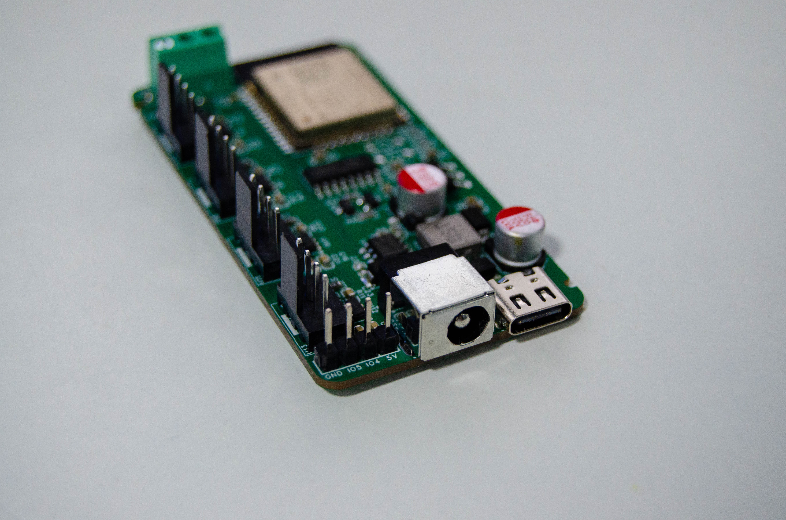
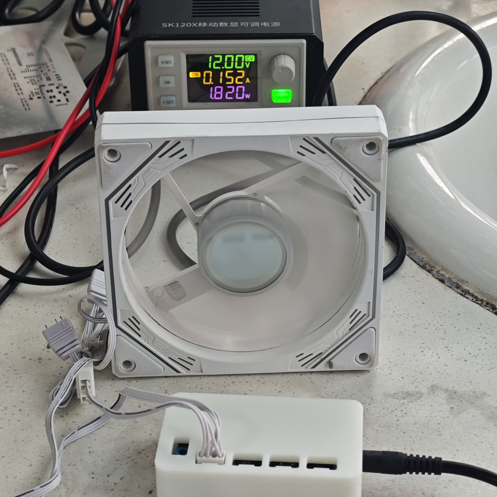
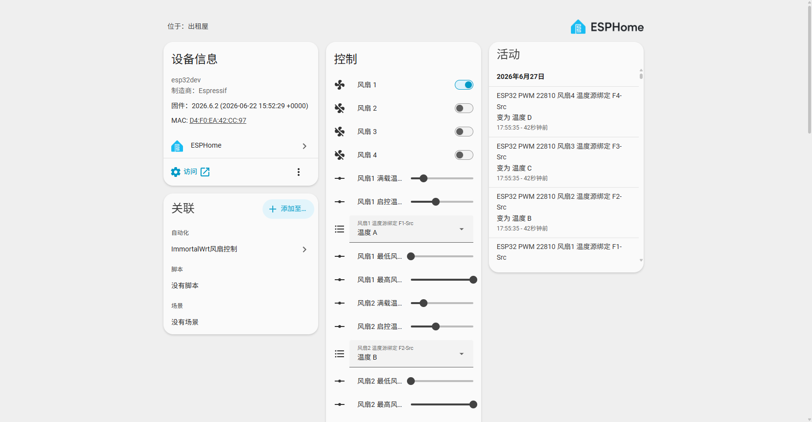
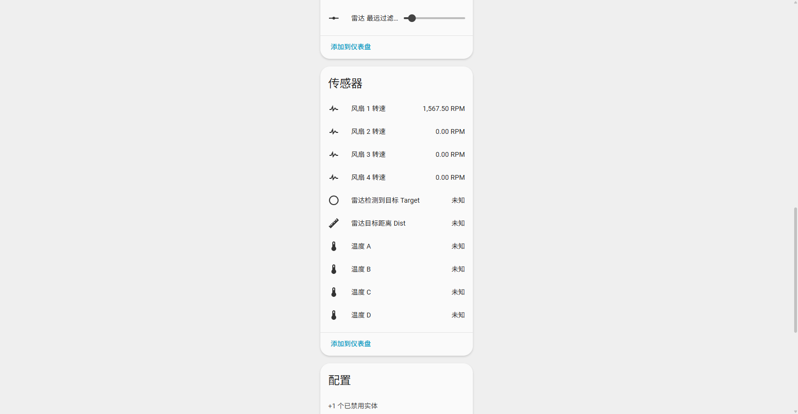
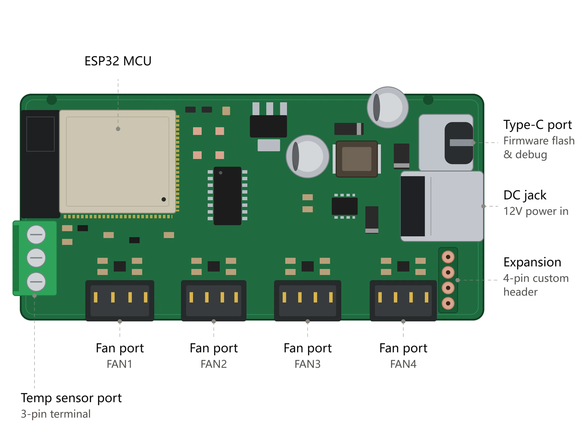
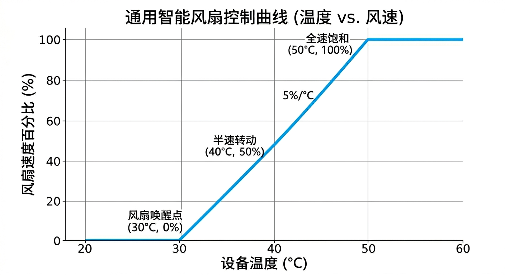

# HomeAssistant-PWM-Fan-Controlx4

<p align="center"><a href="readme.md">English</a> · <a href="README_ZH.md">中文</a></p>


> **English is the primary language of this repository.** Firmware configurations
> are maintained in English first ([`firmware/en/`](./firmware/en/)), with a
> functionally identical Chinese edition in [`firmware/zh/`](./firmware/zh/).
> Documentation is English-first too; the Chinese editions live in
> [`README_ZH.md`](./README_ZH.md) and [`docs/wiki/zh/`](./docs/wiki/zh/Home.md).

An ESPHome-based 4-channel PWM fan controller with Home Assistant integration, a Web control panel, and an HTTP REST API. Each fan can be controlled and monitored independently. The v2.0 firmware also supports DS18B20 temperature control and LD2402G mmWave radar expansion.

<div style="text-align: center;">
  <table>
    <tr>
      <td width="25%" style="padding: 10px;"></td>
      <td width="25%" style="padding: 10px;"></td>
      <td width="25%" style="padding: 10px;"></td>
      <td width="25%" style="padding: 10px;"></td>
    </tr>
  </table>
</div>

<p align="center">
  
</p>

<p align="center"><em>Board layout: ESP32 MCU, Type-C firmware/debug port, 12V DC jack, 4-pin custom header, four fan ports (FAN1–FAN4) and the 3-pin temperature-sensor terminal.</em></p>

## Documentation / Wiki

Beyond this README, the project ships a complete bilingual wiki:

| Topic | English | 中文 |
|:------|:--------|:-----|
| Home / navigation | [Wiki home](./docs/wiki/en/Home-EN.md) | [中文首页](./docs/wiki/zh/Home.md) |
| Quick start | [Getting started](./docs/wiki/en/Getting-Started-EN.md) | [快速上手](./docs/wiki/zh/Getting-Started.md) |
| Firmware and builds | [Firmware](./docs/wiki/en/Firmware-EN.md) | [固件版本](./docs/wiki/zh/Firmware.md) |
| Entities and parameters | [Entities](./docs/wiki/en/Entities-EN.md) | [实体参考](./docs/wiki/zh/Entities.md) |
| Temperature control | [Temperature control](./docs/wiki/en/Temperature-Control-EN.md) | [温度控制](./docs/wiki/zh/Temperature-Control.md) |
| mmWave radar | [mmWave radar](./docs/wiki/en/Radar-EN.md) | [毫米波雷达](./docs/wiki/zh/Radar.md) |
| HTTP API | [HTTP API](./docs/wiki/en/HTTP-API-EN.md) | [HTTP API](./docs/wiki/zh/HTTP-API.md) |
| HA integration and automations | [Home Assistant](./docs/wiki/en/Home-Assistant-EN.md) | [Home Assistant](./docs/wiki/zh/Home-Assistant.md) |
| Hardware | [Hardware](./docs/wiki/en/Hardware-EN.md) | [硬件资料](./docs/wiki/zh/Hardware.md) |
| Troubleshooting | [Troubleshooting](./docs/wiki/en/Troubleshooting-EN.md) | [故障排查](./docs/wiki/zh/Troubleshooting.md) |
| FAQ | [FAQ](./docs/wiki/en/FAQ-EN.md) | [常见问题](./docs/wiki/zh/FAQ.md) |
| Development | [Development](./docs/wiki/en/Development-EN.md) | [开发指南](./docs/wiki/zh/Development.md) |
| Changelog | [Changelog](./docs/wiki/en/Changelog-EN.md) | [更新记录](./docs/wiki/zh/Changelog.md) |

> The wiki sources live in [`docs/wiki/`](./docs/wiki/) and can be published to the GitHub Wiki in one command — see [docs/wiki/README.md](./docs/wiki/README.md) for the publishing workflow and conventions.

## 1. Firmware Versions and Downloads

### 1.1 Check the Hardware First

**Since 2026-11-12 every controller sold is a dual-core model**, and the active firmware is v2.0 built for dual-core operation. The whole v1.0 line (dual-core and single-core) and the v2.0 single-core variants shipped before that date are archived under [`firmware/*/archive/`](./firmware/en/archive/) and are only intended for older hardware.

> A single-core board cannot boot dual-core firmware — owners of an older single-core controller must flash the matching archived single-core build. The other direction is safe: a dual-core board can also run the archived single-core firmware, it just leaves one core idle. v1.0 builds remain available as archived configs for v1.0 boards.

### 1.2 Firmware Selection

| Firmware | CPU | Main Features | Recommended Use |
|:---------|:---:|:--------------|:----------------|
| **v2.0 Basic** | Dual-core | Basic 4-channel fan control, RPM display, Web UI, HTTP API, diagnostics, BLE Proxy | v2.0 hardware without local temperature or radar control |
| **v2.0 DS18B20** | Dual-core | v2.0 Basic features + up to 4 DS18B20 sensors + local automatic speed control | Standalone cooling for servers, racks, and NAS devices |
| **v2.0 DS18B20 + Radar** | Dual-core | DS18B20 features + LD2402G 24GHz mmWave presence detection | Smart home scenarios requiring presence-based fan automation |

> **v1.0 is archived.** Both the v1.0 dual-core and v1.0 single-core configurations live in [`firmware/en/archive/v1.0/`](./firmware/en/archive/v1.0/) and [`firmware/zh/archive/v1.0/`](./firmware/zh/archive/v1.0/); they are no longer built by CI or published in Releases.

All firmware variants support:

- Independent PWM control of 4 fans from 1-100%, including complete power shutdown.
- RPM readings for all 4 fans.
- Home Assistant ESPHome integration, a Web control panel, and an HTTP REST API.
- Diagnostic entities for uptime, Wi-Fi signal, IP address, SSID, and ESPHome version.
- BLE Proxy for extending Home Assistant Bluetooth coverage.

### 1.3 Feature Comparison

| Feature | v2.0 Basic | v2.0 DS18B20 | v2.0 + Radar |
|:--------|:----------:|:------------:|:------------:|
| 4-channel PWM fan control | ✅ | ✅ | ✅ |
| Complete power shutdown | ✅ | ✅ | ✅ |
| Real-time RPM display | ✅ | ✅ | ✅ |
| Web UI / HTTP API | ✅ | ✅ | ✅ |
| Diagnostic entities | ✅ | ✅ | ✅ |
| BLE Proxy | ✅ | ✅ | ✅ |
| DS18B20 temperature control | - | ✅ | ✅ |
| LD2402G mmWave radar | - | - | ✅ |

The archived v1.0 and single-core builds provide the same feature set as their v2.0 counterparts (v1.0 lacks temperature and radar support); only the CPU scheduling differs.

### 1.4 Download Pre-built Firmware

Firmware is compiled and published automatically by GitHub Actions:

[Go to GitHub Releases](https://github.com/YUAXI/HomeAssistant-PWM-Fan-Controlx4/releases)

Each firmware variant includes these 3 file types:

| File Suffix | Purpose |
|:------------|:--------|
| `.firmware.bin` | Standard firmware for regular flashing |
| `.firmware.factory.bin` | Factory firmware for a complete factory reset |
| `.firmware.ota.bin` | OTA upgrade firmware for networked devices |

Release names and their corresponding configuration files. Every active version
is built in two languages — **English is the primary/recommended build**, Chinese
keeps the original entity names:

| Release Name | Language | Configuration File |
|:-------------|:---------|:-------------------|
| `v2.0-basic-en` | English | `firmware/en/v2.0/dual-core/basic/config.yaml` |
| `v2.0-basic-zh` | Chinese | `firmware/zh/v2.0/dual-core/basic/config.yaml` |
| `v2.0-ds18b20-en` | English | `firmware/en/v2.0/dual-core/ds18b20/config.yaml` |
| `v2.0-ds18b20-zh` | Chinese | `firmware/zh/v2.0/dual-core/ds18b20/config.yaml` |
| `v2.0-ds18b20-radar-en` | English | `firmware/en/v2.0/dual-core/ds18b20-radar/config.yaml` |
| `v2.0-ds18b20-radar-zh` | Chinese | `firmware/zh/v2.0/dual-core/ds18b20-radar/config.yaml` |

> **v1.0 and all single-core builds are archived**, not published as release
> artifacts. The configs remain in `firmware/en/archive/` and
> `firmware/zh/archive/` (v1.0 dual-core and single-core, plus the
> pre-2026-11-12 v2.0 single-core variants) if you need to compile one for an
> older board.

The full firmware catalogue, including the language and active/archive
comparison, is in [`firmware/README.md`](./firmware/README.md).

### 1.5 Custom Compilation

To change Wi-Fi, entity names, or other ESPHome settings, edit the corresponding `config.yaml` above and compile or flash it with ESPHome. All active configurations use the ESP32 DevKit board, the ESP-IDF framework, and both CPU cores; only the archived single-core builds set `CONFIG_FREERTOS_UNICORE: "y"`.

### 1.6 Multiple Devices and Device Naming

Every firmware variant enables `name_add_mac_suffix: true`:

- **The same firmware binary can be flashed to any number of devices** — no per-device compilation required.
- At boot, each device appends the last 3 bytes of its own MAC address to its name: the node name looks like `esp32pwm22810-a1b2c3`, and the Home Assistant device name looks like `ESP32 PWM 22810 a1b2c3`.
- Entity IDs carry the same suffix (for example `fan.esp32_pwm_22810_a1b2c3_fan_1` in the English firmware), so several controllers in one network never collide.
- The mDNS hostname (`<node name>.local`) and the OTA target address include the suffix as well.

> **Why this is required**: Home Assistant identifies an ESPHome device by the `name` compiled into its firmware. When several devices share one `name`, HA starts [name conflict resolution](https://www.home-assistant.io/integrations/esphome/#reconfiguration-and-device-replacement), which only offers **Migrate** or **Overwrite** — the device added later overwrites the existing one, and the two can never coexist.

To get tidier names (for example `fanctrl-01`), compile one binary per device with a substitution instead:

```yaml
substitutions:
  device_name: fanctrl-01

esphome:
  name: ${device_name}
  name_add_mac_suffix: false
```

Note: with the suffix enabled, `name` is limited to 24 characters (the ESPHome hostname limit is 31 characters and the suffix takes 7), which `esp32pwm22810` is well below.

## 2. Quick Start

### 2.1 Power Supply

| Power Method | Interface | Voltage | Description |
|:-------------|:----------|:--------|:------------|
| **DC jack (recommended)** | DC barrel jack, 5.5×2.5 mm (5525) | 12V / 2A or higher | Normal operation; powers the fans and ESP32 |
| Type-C port | USB-C | 5V | Flashing and debugging only; cannot drive the fans normally |

### 2.2 First-time Wi-Fi Setup

After startup, the device creates an open Wi-Fi hotspot named `ESP32-Fan-22810`:

1. Connect to `ESP32-Fan-22810` with a phone or computer.
2. Open `http://192.168.4.1` (recommended). The mDNS hostname carries the MAC suffix, for example `http://esp32pwm22810-xxxxxx.local`.
3. Select the target Wi-Fi network and enter its password.
4. The device connects and reboots automatically.

To skip first-time setup, set `wifi.ssid` and `wifi.password` in the configuration file before flashing.

### 2.3 Flash the Firmware

Connect the device to a computer with a Type-C cable, select the firmware matching the hardware, and flash it with the ESPHome flashing tool or `esptool` — flash the very same `.bin` to every device. Once the device is online, use `.firmware.ota.bin` for remote updates and point the OTA target at that device's own IP or hostname.

### 2.4 Add the Device to Home Assistant

Make sure the Home Assistant ESPHome integration is installed:

1. Open **Settings → Devices & Services → Add Integration** and search for **ESPHome**.
2. Select the discovered `ESP32 PWM 22810 xxxxxx` (`xxxxxx` is that device's MAC suffix), or enter its IP address manually.
3. Enter the API encryption key from the configuration files:

   ```text
   LqGIGJ3qyRc+6X6hsMe5vAms+Jyh2lOMh1FQu8yyuzk=
   ```

The following entities are normally created:

| Entity Type | Count | Description |
|:------------|:-----:|:------------|
| Fan | 4 | Independent on/off and 1-100% speed control |
| RPM sensor | 4 | Unit: RPM |
| Temperature sensor | 4 | Only in v2.0 DS18B20 and Radar firmware; Temp A/B/C/D |
| BLE Proxy | 1 | BLE Proxy node |
| Diagnostic entities | Several | Uptime, Wi-Fi signal, IP, SSID, ESPHome version, etc. |

### 2.5 Web Control Panel

Open `http://device-ip` in a browser to access the Web control panel without Home Assistant. The panel shows all 4 fan states, allows independent speed adjustment, and displays device information.

### 2.6 Adding Several Devices Right Away

Because each device carries its own MAC suffix, you can repeat the same steps for any number of controllers: pick the discovered `ESP32 PWM 22810 xxxxxx` under **Settings → Devices & Services** and enter the same API encryption key — the devices coexist as separate entries.

If a device was added earlier while running the old, identically named firmware, delete that stale entry first (**Settings → Devices & Services → ESPHome → Delete**) and add the device again. The name suffix is the last 3 bytes of that device's MAC address, so compare it with the router's DHCP list or the device page to avoid mixing devices up.

## 3. v2.0 Temperature and Radar Features

### 3.1 DS18B20 Wiring

Connect DS18B20 sensors to the onboard **GPIO14** 3-pin header using the 1-Wire bus:

| DS18B20 Pin | Connection |
|:-----------:|:-----------|
| VCC | 3.3V or 5V |
| GND | GND |
| DATA | GPIO14 |

The board includes a pull-up resistor. Up to 4 DS18B20 sensors can be connected in parallel to GPIO14 and are named **Temp A, Temp B, Temp C, and Temp D** according to their bus index.

### 3.2 Local Temperature Control

This section applies to `v2.0-ds18b20` and `v2.0-ds18b20-radar`. In the Home Assistant device page for **ESP32 PWM 22810 xxxxxx**, configure a temperature source and parameters for each fan:

| Parameter | Description | Default |
|:----------|:------------|:-------:|
| Temperature source `F-Src` | Select unbound or Temp A/B/C/D | Fans 1-4 use A-D respectively |
| Trigger temperature `T-Min` | At or below this temperature, power the fan off | 30°C |
| Full-speed temperature `T-Max` | At or above this temperature, use the maximum speed | 50°C |
| Minimum speed `F-Min` | Minimum speed in the linear control range | 0% |
| Maximum speed `F-Max` | Maximum speed in the linear control range | 100% |

Control logic:

```text
Temperature ≤ T-Min                   → Completely power off the fan
T-Min < Temperature < T-Max           → Linear proportional speed control
Temperature ≥ T-Max                   → Run at F-Max
Temperature read failure              → Keep the current speed and state
```

These parameters persist across power cycles. A fan with no bound temperature source is not controlled by the local temperature logic and can still be controlled manually through Home Assistant, the Web UI, or the HTTP API.

### 3.3 LD2402G Radar Interface

The radar UART is enabled only by `v2.0-ds18b20-radar`:

| Radar Pin | Controller Pin |
|:----------|:---------------|
| TX | GPIO4 (UART RX) |
| RX | GPIO5 (UART TX) |
| Power / Ground | 5V / GND on the v2.0 developer header |

The UART speed is `115200`. The radar firmware provides target presence and target distance entities, plus configurable minimum and maximum distance filters. The default range is `0.10-1.5 m`. Use Home Assistant automations to link radar presence with fan and temperature control.

## 4. Home Assistant Temperature Automation

The v2.0 DS18B20 firmware already supports local temperature control. The following method works with all firmware versions and is especially useful for v2.0 Basic, the archived v1.0 builds, or for external temperature sources such as CPU and ambient temperature sensors exposed by Home Assistant.

### 4.1 Configuration Steps

1. Open Home Assistant → **Automations & Scenes → Create Automation**.
2. Select **More → Edit in YAML** in the top-right corner.
3. Paste the template below.
4. Replace the temperature sensor and fan entity IDs, then save.

### 4.2 YAML Template

```yaml
alias: "Smart Fan Linear Speed Control"
description: "Linearly controls fan PWM duty cycle based on temperature sensor readings"
mode: restart

trigger:
  - platform: state
    entity_id: sensor.nas_temperature_x86_pkg_temp  # Change this

condition:
  - condition: template
    value_template: "{{ is_number(states('sensor.nas_temperature_x86_pkg_temp')) }}"  # Change this

action:
  - service: fan.set_percentage
    target:
      entity_id: fan.fan_1  # Change this
    data:
      percentage: >
          {# Change this #}
        
        
        
        
        
          {{ f_min }}
        
          {{ f_max }}
        
          
          {{ result | round(0) | int }}
        
```



Common temperature source examples:

| Temperature Source | Integration | Example Entity ID |
|:-------------------|:------------|:------------------|
| PC / server CPU | Glances | `sensor.nas_temperature_x86_pkg_temp` |
| Temperature / humidity sensor | Zigbee2MQTT / ZHA | `sensor.temperature_humidity_sensor_temperature` |
| Air conditioner / heater | Smart AC integration | `climate.living_air_conditioner` |
| Synology NAS | Synology DSM integration | `sensor.synology_disk_1_temperature` |
| Other ESPHome device | ESPHome integration | Use the actual entity ID |

## 5. HTTP REST API

The built-in Web Server accepts LAN HTTP requests for fan control and sensor readings. Use **POST** for control commands and **GET** for status queries. The English firmware uses ASCII entity names, so most URLs need no special encoding (spaces become `%20`); the Chinese build keeps Chinese names and therefore needs full UTF-8 percent-encoding.

### 5.1 Entity and Path Examples

ESPHome generates entity IDs from the configured `name`. The following examples show Fan 1 of the English build:

| Entity Name | HA `entity_id` (example with MAC suffix) | URL Path |
|:------------|:-----------------------------------------|:---------|
| Fan 1 | `fan.esp32_pwm_22810_a1b2c3_fan_1` | `/fan/Fan%201` |
| Fan 1 RPM | `sensor.esp32_pwm_22810_a1b2c3_fan_1_rpm` | `/sensor/Fan%201%20RPM` |

Replace the entity name in the path for other fans. Alternatively, use Home Assistant's `fan.set_percentage` service to avoid handling URL encoding manually.

> The `zh/` builds use names such as `风扇 1` and `风扇 1 转速`, so their paths are percent-encoded (for example `/fan/%E9%A3%8E%E6%89%87%201`).

### 5.2 Python Example

```python
import requests
from urllib.parse import quote

base = "http://10.0.20.83"  # Replace with the device IP

# Turn on Fan 2 and set it to 50%
requests.post(f"{base}/fan/{quote('Fan 2')}/turn_on", params={"speed_level": 50})

# Turn off Fan 2
requests.post(f"{base}/fan/{quote('Fan 2')}/turn_off")

# Read the RPM of Fan 1
response = requests.get(f"{base}/sensor/{quote('Fan 1 RPM')}")
if response.status_code == 200:
    print("Current RPM:", response.json()["value"])
```

## 6. Hardware Files and Interfaces

### 6.1 Hardware Files

v2.0 is the recommended hardware version:

| Type | v2.0 File | v1.0 File |
|:-----|:----------|:----------|
| PCB Gerber | [gerber.zip](./hardware/v2.0/pcb/gerber.zip) | [gerber.zip](./hardware/v1.0/pcb/gerber.zip) |
| BOM | [bom.xlsx](./hardware/v2.0/pcb/bom.xlsx) | [bom.xlsx](./hardware/v1.0/pcb/bom.xlsx) |
| LCSC EDA project | [project.epro2](./hardware/v2.0/pcb/project.epro2) | [project.epro2](./hardware/v1.0/pcb/project.epro2) |
| Enclosure body | [case.STEP](./hardware/v2.0/3d-models/print/case.STEP) | [case.step](./hardware/v1.0/3d-models/print/case.step) |
| Top cover | [top-cover.STEP](./hardware/v2.0/3d-models/print/top-cover.STEP) | [top-cover.step](./hardware/v1.0/3d-models/print/top-cover.step) |

### 6.2 Fan Pin Mapping

| Fan | PWM Output | Tachometer Input | Power Management |
|:---:|:----------:|:----------------:|:----------------:|
| Fan1 | GPIO16 | GPIO32 | GPIO21 |
| Fan2 | GPIO17 | GPIO33 | GPIO22 |
| Fan3 | GPIO18 | GPIO25 | GPIO23 |
| Fan4 | GPIO19 | GPIO26 | GPIO13 |

Additional v2.0 interfaces:

| Interface | Description |
|:----------|:------------|
| GPIO14 (3-pin header) | DS18B20 1-Wire temperature bus |
| 4-pin developer header (5V / GND / GPIO5 / GPIO4) | Expansion for LD2402G radar, RS485, and other peripherals |

### 6.3 Hardware Design Highlights

- **Fan power control**: `TPS22810DBVR` directly cuts fan power for complete shutdown.
- **Power scheme**: 12V → 5V (`TPS5430DDAR` DC-DC) → 3.3V (`AMS1117-3.3`).
- **USB-to-Serial**: Onboard `CH340C` for flashing and debugging over Type-C.

## 7. Changelog

| Date | Changes |
|:-----|:--------|
| 2026-11-15 | The **entire v1.0 line** (dual-core and single-core) was archived to `firmware/*/archive/v1.0/`; Releases now contain only the v2.0 dual-core builds (6 artifacts: 3 variants × 2 languages). |
| 2026-11-14 | v2.0 firmware is now built for **dual-core** operation (all controllers sold after 2026-11-12 are dual-core); single-core builds were moved to `firmware/*/archive/` and are no longer published as release artifacts. Added the Tindie purchase link for the assembled controller. |
| 2026-11-14 | English-first release: pure-English firmware configs for every variant in `firmware/en/`, Chinese originals moved to `firmware/zh/`, and English promoted to the primary repository language (`readme.md`). |
| 2026-11-09 | Added a bilingual wiki (`docs/wiki/`): quick start, firmware, entity reference, temperature control, mmWave radar, HTTP API, HA automations, hardware, troubleshooting, FAQ, development guide, and changelog. |
| 2026-10-14 | Firmware now enables `name_add_mac_suffix`: one binary can be flashed to many devices and each one is added to HA separately instead of overwriting the previous device. |
| 2026-08-16 | Fans are powered off when automatic control temperature is at or below `T-Min`, and restart when the temperature rises. |
| 2026-07-10 | On DS18B20 read failure, keep the current fan speed and remove forced full-speed protection. |
| 2026-07-01 | Added BLE Proxy to all variants; enabled CI firmware builds and Release publishing; removed pre-built firmware from the repository. |
| v2.0 | Added DS18B20 temperature control, the mmWave radar firmware, and the v2.0 hardware design. |
| v1.0 | Added the Web UI, HTTP REST API, and diagnostic entities. |

## 8. Support and License

Purchasing the assembled controller:
[**ESP32 4-Channel PWM Fan Controller on Tindie**](https://www.tindie.com/products/esphome-fan-controllers/esp32-4-channel-pwm-fan-controller-homeassistant/)

Community group QR codes are no longer maintained.

<div style="text-align: center;">
  <table>
    <tr>
      <td width="50%" style="padding: 10px;"><p><small>WeChat Pay</small></p></td>
      <td width="50%" style="padding: 10px;"><p><small>Alipay</small></p></td>
    </tr>
  </table>
</div>

This project is licensed under the [MIT License](./LICENSE).
